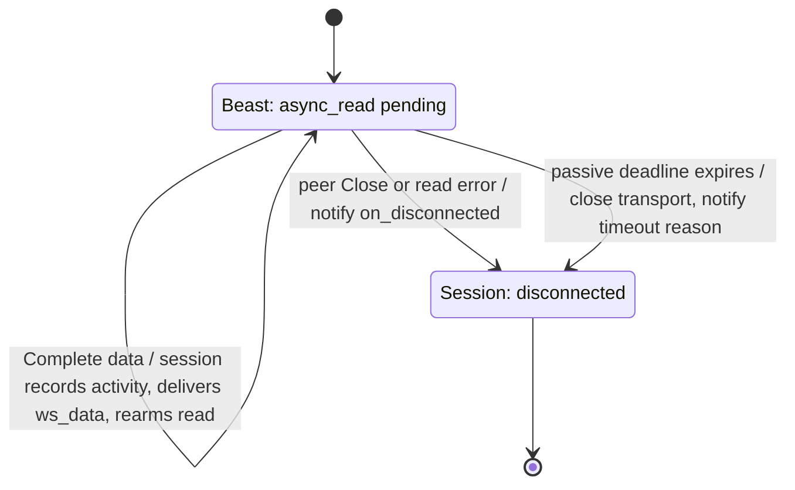
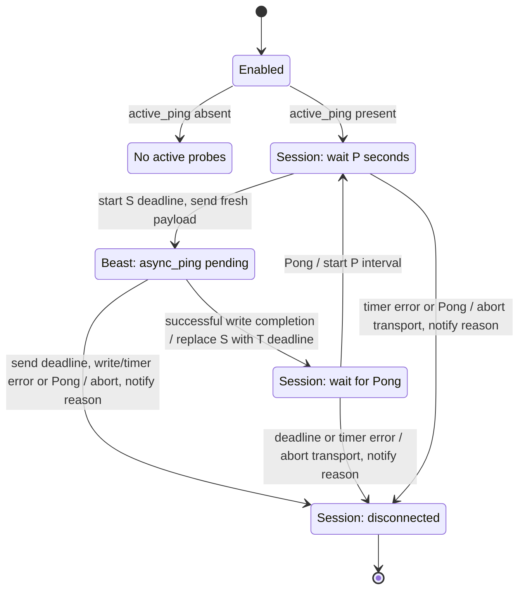
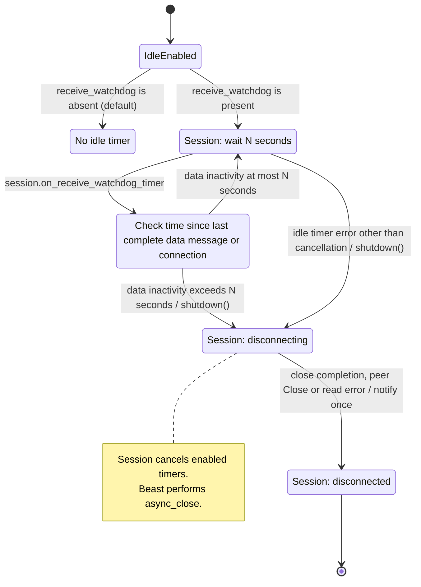
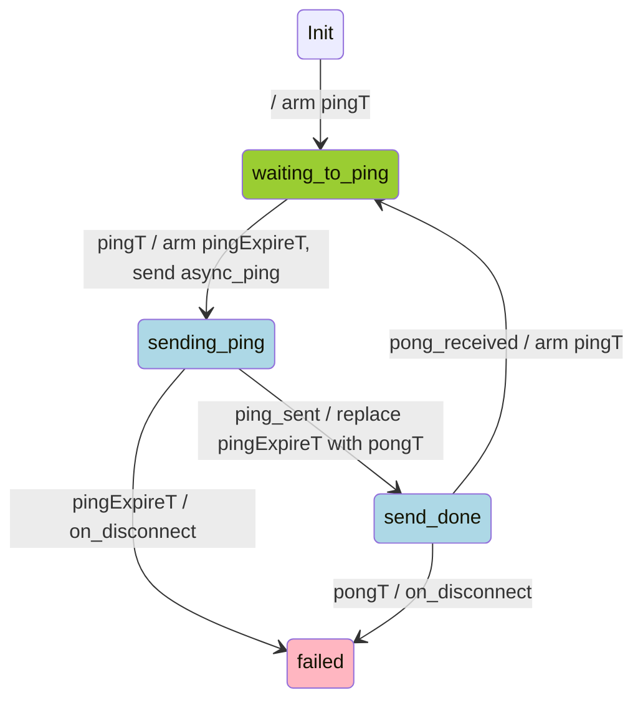

**WebSocket heartbeat review and interface proposal — 2026-11-02**

Research for [WS-06](ws_current_work.md#ws-06), principally `WS-PING` and `WS-IDLE`.
This is a proposal, not an implemented contract. Exchange requirements below were checked
against official documentation; authenticated connections and order submission were not tested.

We need three independent observations: **transport activity**, **exchange heartbeat health**,
and **useful application progress**. A control Pong does not establish that subscriptions are
working, and a healthy private feed may have no order/account updates for a long time.

**1. Subscriber review findings**

The reviewed subscriber logic exhibits five patterns:

| Pattern | Observed behavior | Consequence for our design |
| --- | --- | --- |
| Server control Ping | Binance-style RFC Ping/Pong exchange. | Keep automatic transport replies independent of optional client probes. |
| Client control Ping | Periodic or receive-idle probes; some handlers also measure RTT from the echoed payload. | Sending a Ping and receiving its matching Pong are separate events. |
| Client application ping | OKX-style text `ping` / `pong`. | Ordinary WebSocket data messages, handled above the transport. |
| Server application ping | HTX-style timestamp echo and LBank-style identifier echo; HTX MD requires decompression first. | Recognize and reply on the same connection, preserving the required value. |
| One-way heartbeat | Coinbase/Kraken-style heartbeat notifications, also seen with Bitfinex. | Record activity without replying or treating the notification as market data. |

The reviewed receive-idle logic generally treated any incoming traffic as proof of life;
it was not uniformly a matched-Pong watchdog. Connection keepalive, MD freshness, and
application heartbeat replies therefore need explicit policies. HTTP heartbeat settings
found alongside subscribers do not establish WebSocket behavior. The matrix below supplies
the current endpoint-specific requirements rather than deriving them from these patterns.

**2. Exchange requirements**

**Control** means RFC Ping/Pong frames; **application** means ordinary text/binary messages.
Intervals are server requirements or recommendations as marked, not proposed library defaults.
“REST entry” describes the cited API family; it is not a claim about every product offered
by that exchange. A private order-update channel alone does not provide order entry.

| Exchange / API family | Market data | Private feeds | Order entry / differences |
| --- | --- | --- | --- |
| **Binance — Spot, USD-M** | Server **control** Ping: Spot every **20 s**, Pong within **1 min**; USD-M every **3 min**, Pong within **10 min**. Echo the payload. [Spot](https://github.com/binance/binance-spot-api-docs/blob/master/web-socket-streams.md#general-wss-information), [USD-M](https://developers.binance.com/en/docs/products/derivatives-trading-usds-futures/websocket-market-streams/Connect). | Spot supports user-data subscriptions on its WS API. USD-M listen keys need renewal within **60 min**, independently of socket Pongs. [Spot API](https://github.com/binance/binance-spot-api-docs/blob/master/web-socket-api.md), [USD-M lifecycle](https://developers.binance.com/en/docs/products/derivatives-trading-usds-futures/user-data-streams). | Both have WS order APIs. Spot retains **20 s / 1 min**, USD-M **3 min / 10 min** control policy. Connections have **24 h** lifetime. JSON RPC `ping` or listen-key renewal is distinct from control Pong. [USD-M WS API](https://developers.binance.com/en/docs/products/derivatives-trading-usds-futures/websocket-api-general-info). |
| **Coinbase — Advanced Trade** | Subscribe to application `heartbeats`: approximately **1 s**, no reply. Prevents quiet subscriptions closing after **60–90 s**. [Endpoints](https://docs.cdp.coinbase.com/coinbase-app/advanced-trade-apis/websocket/websocket-endpoints). | The separate user endpoint also supports `heartbeats`; subscribe within **5 s** of connecting. [Overview](https://docs.cdp.coinbase.com/coinbase-app/advanced-trade-apis/websocket/websocket-overview). | [REST entry](https://docs.cdp.coinbase.com/api-reference/advanced-trade-api/rest-api/orders/create-order); WS delivers order updates. This row does not prescribe behavior for Coinbase Exchange, International, or other API families. |
| **Upbit** | **120 s** idle limit; control Ping supported. Text `PING` is an alternative that starts `{"status":"UP"}` notifications every **10 s**, rather than a single Pong. [Guide](https://global-docs.upbit.com/reference/websocket-guide). | Authenticated private endpoint follows the connection guide; order events can legitimately be absent. [MyOrder](https://global-docs.upbit.com/reference/websocket-myorder). | [REST entry](https://global-docs.upbit.com/reference/api-overview); WS subscriptions provide market/account events. |
| **OKX — v5** | Application text `ping` → `pong`: after receive silence of **N < 30 s**, send Ping, then reconnect if no Pong within N. [Connection rules](https://www.okx.com/docs-v5/en/#overview-websocket-connect). | Same connection rule on private/business connections; authentication and subscriptions are separate from heartbeat. | WS `order` on authenticated private connection; same text heartbeat. [Place order](https://www.okx.com/docs-v5/en/#order-book-trading-trade-ws-place-order). |
| **Bybit — v5** | Application JSON `op:ping`, recommended every **20 s**. Response shape varies by endpoint. [Connect](https://bybit-exchange.github.io/docs/v5/ws/connect). | Private and trade endpoints support configurable `max_active_time` (**30–600 s**); default idle allowance is **10 min**. | Separate WS trade endpoint; JSON ping/pong also applies, with its own response envelope. [Trade guide](https://bybit-exchange.github.io/docs/v5/websocket/trade/guideline). |
| **Bitget — UTA** | Text `ping` → `pong` every **30 s** recommended; disconnect after **2 min** without Ping. [Quick start](https://www.bitget.com/docs/uta/quick-start). | Same policy on UTA private connection. | WS `op:trade`, including `place-order`, uses the private connection. Acceptance acknowledgement is separate from execution updates. [Order channel](https://www.bitget.com/docs/uta/websocket/private/Place-Order-Channel). |
| **Gate — Spot v4 / Futures** | Server **control** Ping requires Pong. Optional application `spot.ping` / `futures.ping` provides additional checks; no fixed cadence is assumed here. [Spot](https://www.gate.com/docs/developers/apiv4/ws/en/#application-ping-pong), [Futures](https://www.gate.com/docs/developers/futures/ws/en/#ping-and-pong). | Authenticated subscriptions share the corresponding family's connection rules. | WS `spot.order_place` / `futures.order_place` supported; use the same family-specific heartbeat, not a universal JSON payload. [Spot entry](https://www.gate.com/docs/developers/apiv4/ws/en/#order-place), [Futures API](https://www.gate.com/docs/developers/futures/ws/en/). |
| **KuCoin — Classic / UTA** | Classic uses JSON `type:ping`; read `pingInterval` and `pingTimeout` from token/endpoint discovery. UTA uses `op:ping` and welcome-message settings. [Classic](https://www.kucoin.com/docs-new/websocket-api/base-info/introduction), [UTA](https://www.kucoin.com/docs-new/websocket-api/introduction). | Each connection owns its negotiated schedule. Current examples show **18 s / 10 s**; do not hard-code them as universal constants. | UTA provides a WS trade connection. Its heartbeat envelope differs from Classic; negotiated settings belong to that adapter instance. |
| **MEXC — Spot v3 / Futures** | Spot JSON `method:PING` → `msg:PONG`; inactive subscriptions can close after **60 s**, and an unsubscribed connection after **30 s**. Data is Protobuf. [Spot streams](https://www.mexc.com/api-docs/spot-v3/websocket-market-streams), [Ping format](https://mexcdevelop.github.io/apidocs/spot_v3_en/#ping-pong-mechanism). Futures uses lowercase `method:ping`, recommended **10–20 s**, closing after **60 s** without Ping. [Futures commands](https://www.mexc.com/api-docs/futures/websocket-api/command-details-for-data-exchange). | Spot listen keys additionally expire after **60 min** without renewal; connection lifetime **24 h**. [User streams](https://www.mexc.com/api-docs/spot-v3/websocket-user-data-streams/). | [Spot REST entry](https://www.mexc.com/api-docs/spot-v3/spot-account-trade/new-order), [Futures trade API](https://www.mexc.com/api-docs/futures/trade/); private push streams are distinct from submission. |
| **HTX — Spot / derivatives** | Spot server JSON `ping` timestamp every **5 s**; reply with matching `pong`; two missed heartbeats disconnect. MD arrives gzip-compressed in binary messages. [Spot heartbeat](https://huobiapi.github.io/docs/spot/v1/en/#heartbeat-and-connection). | Spot `/ws/v2` uses uncompressed `action:ping`, nested `data.ts`, approximately **20 s**; reply `action:pong`. Derivatives private feeds use an `op:ping` / `op:pong` envelope. [Spot private](https://huobiapi.github.io/docs/spot/v1/en/#websocket-account-and-order), [Derivatives](https://huobiapi.github.io/docs/dm/v1/en/#websocket-heartbeat-and-authentication-interface). | Order submission is REST in these documented families; WS account/order sections describe updates. Do not reuse the MD heartbeat classifier for private messages. |
| **Crypto.com — Exchange v1** | Server application `public/heartbeat` every **30 s**; send `public/respond-heartbeat` with the same ID within **5 s**. [WS specification](https://exchange-developer.crypto.com/exchange/v1/docs/api/websocket-single-page/). | Same protocol on `/user` as `/market`. | WS `private/create-order` uses `/user`; keep heartbeat replies prompt even during order bursts. Cancel-on-disconnect is a separate trading policy. [WS methods](https://exchange-developer.crypto.com/exchange/v1/docs/api/websocket-single-page/). |
| **Kraken — Spot v2 / Futures** | Spot emits an application heartbeat about every **1 s when other updates are absent**, after subscribing; no reply. Optional JSON `method:ping` returns Pong. [Heartbeat](https://docs.kraken.com/exchange/api-reference/spot-websocket-v2/heartbeat), [Ping](https://docs.kraken.com/exchange/api-reference/spot-websocket-v2/ping). | Spot authenticated subscriptions have the same application Ping option. Futures separately requires a Ping at least every **60 s**; its official client demonstrates **control** pings. [Futures guide](https://docs.kraken.com/exchange/guides/futures/websockets), [client](https://github.com/CryptoFacilities/WebSocket-v1-Python/blob/master/cfWebSocketApiV1.py). | Spot v2 supports authenticated WS [add_order](https://docs.kraken.com/exchange/api-reference/spot-websocket-v2/add_order). Do not infer Futures WS order-entry support from the streaming guide. |
| **LBank — Spot v2** | Server JSON `action:ping` includes an identifier; reply `action:pong` with it within **1 min**. Client-initiated application Ping is also supported. [Specification](https://www.lbank.com/docs/). | Same WS family; additionally renew `subscribeKey` before its **60 min** expiry. | REST entry; WS `orderUpdate` is notification. [Trading and private streams](https://www.lbank.com/docs/). |
| **XT.com — Spot / Futures** | Spot text `ping` → `pong`, with **1 min** maximum silence between Pings. Futures requires text Ping within **30 s**. [Spot](https://doc.xt.com/docs/spot/WebSocket%20Public/Heartbeat), [Futures](https://doc.xt.com/docs/futures/WebsocKetV2/General_WSS_information). | Futures private repeats the **30 s** rule. Spot private heartbeat cadence is **not explicit in the reviewed pages**; its access token lasts **2 days**. [Futures private](https://doc.xt.com/docs/futures/UserWebsocket/General_WSS_information), [Spot private](https://doc.xt.com/docs/spot/WebSocket%20Private/GeneralWSSInfo), [token](https://doc.xt.com/docs/spot/WebSocket%20Private/GetWsToken). | [Spot REST entry](https://doc.xt.com/docs/spot/Order/SubmitOrder). Confirm Spot private heartbeat behavior before adopting the public interval. |
| **bitFlyer — Lightning JSON-RPC** | Raw JSON-RPC over WebSocket is available. The reviewed official pages do **not specify a numeric heartbeat cadence**. Keep RFC replies enabled; any client probe schedule is our policy pending verification. [Realtime API](https://bf-lightning-api.readme.io/docs/realtime-api), [JSON-RPC](https://bf-lightning-api.readme.io/docs/endpoint-json-rpc). | Authenticate and subscribe to private channels over JSON-RPC. Socket.IO is an alternative protocol with additional framing, not interchangeable with raw WS. | [HTTP order entry](https://lightning.bitflyer.com/docs#send-a-new-order); private WS channels deliver order events. |
| **Deribit — JSON-RPC v2** | Enable `public/set_heartbeat`, interval **10–300 s**. Informational heartbeat needs no reply; `test_request` requires `public/test`. Control Ping/Pong does **not** satisfy this application mechanism. [Heartbeat contract](https://docs.deribit.com/api-reference/session-management/public-set_heartbeat). | Same connection mechanism before/after authentication; client JSON activity affects the timer. | WS [private/buy](https://docs.deribit.com/api-reference/trading/private-buy) and corresponding trading methods. Heartbeat disconnect can cancel orders if cancel-on-disconnect was enabled. |

Two details matter when implementing these profiles:

- **Deribit:** the detailed method contract distinguishes no server output for `interval`
  (informational heartbeat) from no client JSON input for `interval + 500 ms` (test request).
  Continued client silence closes at `2 × interval + 500 ms`. Sending control Pongs cannot
  prevent that application timeout. [Detailed contract](https://docs.deribit.com/api-reference/session-management/public-set_heartbeat).
- **Rate/lifetime budgets:** heartbeat messages can consume the same incoming-message budget
  as subscriptions, e.g. Binance Spot's **5 messages/s** includes control Ping/Pong and JSON.
  Heartbeats also do not extend a mandatory connection lifetime or renew a private-feed lease.
  [Binance limits](https://github.com/binance/binance-spot-api-docs/blob/master/web-socket-streams.md#websocket-limits).

**3. RFC and Beast behavior**

RFC 6455 defines Ping/Pong as unfragmented control frames with at most **125 payload bytes**.
A Pong answering a Ping echoes its payload; unsolicited Pongs are allowed and need no reply.
Control frames can appear between fragments of a data message. The RFC prescribes no periodic
heartbeat interval and no JSON/text heartbeat format. [RFC 6455 §5.5](https://www.rfc-editor.org/rfc/rfc6455.html#section-5.5).

Beast handles incoming control frames during reads and automatically replies to Ping.
The control callback observes the frame; it does not replace that reply. A read must be
active, and the executor must keep running. Its internal coordination permits a read, a data
write, and a ping/pong operation to coexist under the documented operation rules; it does not
permit arbitrary concurrent operations. [Control frames](https://www.boost.org/doc/libs/latest/libs/beast/doc/html/beast/using_websocket/control_frames.html).

The installed Boost **1.90.0** implementation was inspected: `websocket/impl/read.hpp`
constructs the automatic Pong with the received payload; `impl/ping.hpp` coordinates its
write with other asynchronous writers. `async_ping` completes when the Ping is written or
fails, **not when a Pong arrives**. Do not initiate another explicit ping/pong operation until
it completes. [async_ping contract](https://www.boost.org/doc/libs/latest/libs/beast/doc/html/beast/ref/boost__beast__websocket__stream/async_ping.html).

Beast can also supply receive-idle timeouts and automatic idle probes, but our agreed policy
is to keep both disabled and own the timer/state transitions. Its handshake/close timeout
remains separate. TCP keepalive is yet another mechanism and cannot replace exchange application
heartbeats. [Beast timeouts](https://www.boost.org/doc/libs/latest/libs/beast/doc/html/beast/using_websocket/timeouts.html).

**4. Our interface: gaps and proposed changes**

**Current handling — checked 2026-11-03**

The [session implementation](web_socket.cpp) schedules one control probe at a time with a
fresh payload when `active_ping` is present (default: absent). **Beast sends automatic
Pong replies** during reads, regardless of that setting. Beast's own idle timeout and automatic
keepalive Pings are disabled by the client timeout settings.

These three diagrams start after a successful handshake and an `on_connected` callback that
leaves the session connected. They describe concurrent operations, not additional session
states. `P` means `active_ping->ping_period_sec` (default when enabled: 20), and `N` means
`receive_watchdog->timeout_sec` (30 when enabled; the watchdog is absent by default).
These durations, `active_ping->pong_timeout_sec` (`T` below), `async_operation_timeout_sec` (`S`), and
`passive_ping->ping_timeout_sec` are independent. Enabled policies start after the handshake.
The passive deadline is measured from handshake completion, then from each server control Ping;
data and Pongs do not refresh it.

**A. Incoming traffic — Beast reads/replies; the session enforces the optional server-Ping deadline**

**B. Active probing — the session schedules and enforces; Beast writes**

This overview shows scheduling and ownership. The separate [active Ping state machine](#active-ping-state-machine)
defines the probe statuses and event mapping.

**C. Receive-data watchdog — the session checks inactivity and initiates shutdown**

Across all three paths, explicit `close()` closes the socket, cancels enabled timers and sets
`disconnected` without a delegate notification. Ping/idle callbacks stop scheduling work
once the session is disconnecting or disconnected.

- **Active Ping send and Pong deadlines are enforced.** `async_operation_timeout_sec` bounds
  the Ping write, including waiting behind another control write. Successful completion replaces
  that deadline with `pong_timeout_sec`. Every control Pong is an event, regardless
  of payload: `send_done` starts the next interval; `waiting_to_ping` and `sending_ping` fail.
  Pong and timeout events are handled in dispatch order. Data and server Pings cannot satisfy
  the probe. Timeout aborts and reports `Active Ping send timeout: write did not complete within N seconds`
  or `Active Pong timeout: no Pong within N seconds`.
  Write/timer errors also abort with a reason.
- **The receive watchdog tracks complete data messages.** Its baseline is set at connection
  and refreshed only by complete data receipt. Control Pings/Pongs and partial-message progress
  do not refresh it; active/passive Ping policies operate independently.
  Checks run every `timeout_sec` (default 30 s), with no grace or tolerance. An unrounded
  inactivity duration exceeding the timeout initiates graceful shutdown. This remains periodic
  sampling: data receipt does not reschedule the next check. Waiting for the close handshake
  is intentional for data inactivity. The existing watchdog log records the cause;
  `on_disconnected` retains its close-result reason without a dedicated watchdog reason.
  `receive_watchdog` is absent by default, so no idle timer runs. Enabling a `receive_data_watchdog`
  requires a positive `timeout_sec`; disabling it does not disable outgoing Pings or automatic Pong replies.
- **Terminal cleanup cancels all enabled policies.** Explicit close, peer Close, read errors,
  and graceful shutdown cancel active/passive Ping and receive-watchdog waits. Late completions
  cannot rearm a terminal session or emit another terminal event.
- **Passive Ping deadlines are enforced.** A missed deadline aborts the transport and emits
  one `on_disconnected` with `Passive Ping timeout: no server Ping within N seconds`, without
  waiting for a close handshake. Pings still receive automatic Pongs with monitoring disabled.
  Application heartbeats still reach the application as ordinary `ws_data`.

Source entry points: `on_handshake`, `on_control`, `on_active_ping_timer`, `on_active_ping_expire_timer`, `on_active_pong_timer`,
`on_active_ping`, `on_active_pong`, `on_receive_watchdog_timer`, `on_receive`, `shutdown`, `on_shutdown`, and `close`
in [web_socket.cpp](web_socket.cpp).
Beast ownership is documented in [control-frame handling](https://www.boost.org/doc/libs/latest/libs/beast/doc/html/beast/using_websocket/control_frames.html)
and [Ping write completion](https://www.boost.org/doc/libs/latest/libs/beast/doc/html/beast/ref/boost__beast__websocket__stream/async_ping.html).

**Application distinction:** application heartbeats and subscription acknowledgements are
ordinary data messages and still refresh this watchdog. Recognizing useful market data
requires exchange-adapter participation. Periodic checks, graceful shutdown, and log-only
reporting of the watchdog cause are the agreed completed policy; live validation remains pending.

Other interface gaps: no public control-frame event; `ws_data` supplies bytes without
text/binary metadata; `send()` blocks and reports local write completion.

Recommended responsibility split:

| Layer | Owns |
| --- | --- |
| `web_socket` session | RFC framing/replies, continuous reading, optional control-heartbeat policies and complete-message watchdog, setup/close deadlines, terminal cleanup and diagnostics. |
| Exchange connection adapter | Application heartbeat encoding/replies, negotiated intervals, authentication, subscription acknowledgement, token renewal and reconnect readiness. |
| MD/order consumer | Per-channel/symbol freshness, sequence continuity, order-response deadlines and reconciliation of unknown outcomes. |

**Minimal interface direction:**

1. Separate optional **server control-Ping monitoring** and **client control-Ping/Pong
   probing** from data-idle detection. Use precise steady-clock deadlines for control
   expectations. Control traffic must not satisfy the future useful-data idle policy;
   define that policy separately.
2. Add text/binary kind to `ws_data`. HTX gzip and MEXC Protobuf need adapter decoding; gzip
   here is application compression, separate from WebSocket compression. Bound decoded output
   as well as the received message. Preserve the existing borrowed-payload lifetime contract.
3. Keep application heartbeats on ordinary `send()` and receive events. Start with small
   adapter-owned timers and bounded string recognition for known heartbeat envelopes; no DOM
   parser or exchange JSON policy in `web_socket`. Match required IDs/timestamps, tolerate
   documented whitespace/order variation, and do not classify arbitrary messages by a loose
   search for `ping`/`pong`. Reply before expensive downstream processing.
4. Keep runtime-negotiated settings, such as KuCoin welcome values, in the adapter. They do
   not require weakening `update_params()`'s prohibition on active-session changes. Extract a
   shared application-heartbeat helper only after concrete adapters establish common needs.

**Selected control-probe policy:** `active_ping` enables periodic control-Ping probes, one
outstanding at a time. `ping_period_sec` is the delay before the first probe and between a
completed probe and the next send; `pong_timeout_sec` bounds the wait for a control Pong
from successful Ping write completion. `async_operation_timeout_sec` separately bounds the
Ping send from initiation to completion. All three waits reuse one timer.
The values are independently positive: a timeout longer than the period cannot cause overlapping
probes. Keep both control policies absent for application-only heartbeat protocols. Public
control observation/manual Ping remains deferred until a consumer needs it. Automatic replies
to server control Pings always remain enabled.

**Sending and orders:** a blocking write or long delegate callback can delay reads, automatic
Pongs, application replies and timers. Meeting bounded response times under a stalled peer may
require an owned, bounded asynchronous send path. That is a separate design decision;
[WS-03](ws_current_work.md#ws-03) remains closed as unconfirmed. Define queue acceptance, local
write completion and exchange acknowledgement separately, and coordinate data/control/close
operations. Prioritizing a heartbeat between queued messages cannot preempt bytes already being
written. Do not replay an order automatically after a timeout/reconnect: its outcome may be
unknown. Reconcile by client/order ID; choose cancel-on-disconnect explicitly in the order adapter.

Report receive-idle expiry in the existing watchdog log. Keep diagnostic distinctions for
Pong deadlines, heartbeat protocol failures, send failures and peer closure. A private-feed lease expiry and an order-acknowledgement
timeout belong above the transport. A busy symbol must not hide another subscription's stalled
data. Use the future [timer/execution abstraction](current_work.md) when available without making
its implementation a prerequisite for WS-06.

**5. Suggested implementation order and evidence**

1. **DEV-DONE/LIVE-TEST-PENDING — control Pings:** active/passive deadlines, Pong event dispatch,
   terminal cancellation, and reconnect safety are covered by local TLS tests.
2. **DEV-DONE/LIVE-TEST-PENDING — receive watchdog:** the complete-message, periodic-check policy
   is implemented, with control-only and actual-data-refresh coverage. Validate live data silence;
   keep Beast idle management disabled. Useful market-data classification remains adapter work.
3. **Application profiles:** local peers for text ping/pong, timestamp/ID echo, server challenges,
   one-way heartbeat, binary/compressed heartbeat and negotiated intervals. Verify healthy
   private silence separately from missing MD. Add text/binary metadata with focused coverage.
4. **Load and failure boundaries:** subscription bursts, heartbeat behind large/stalled writes,
   rate limits, token renewal and planned server disconnect. Decide whether bounded asynchronous
   sending is needed from this evidence. Use simulated order replies;
   live orders are unnecessary for heartbeat testing.

Connection-deadline development and live/network-loss validation remain owned by WS-06.
`WS-TIMER-GENERATION` is **POSTPONED** to the [shared WebSocket/HTTP timer class](current_work.md#timer-cancellation).

## Active Ping state machine

Implemented event mapping: `pingT` → `on_active_ping_timer`,
`pingExpireT` → `on_active_ping_expire_timer`, `ping_sent` → `on_active_ping`,
`pongT` → `on_active_pong_timer`, and `pong_received` → `on_active_pong`.

One timer serves three successive waits: `pingT` uses `ping_period_sec`, `pingExpireT` uses
`async_operation_timeout_sec`, and `pongT` uses `pong_timeout_sec`. Arm `pingExpireT` before
initiating `async_ping`; successful write completion replaces it with a fresh `pongT` wait.
Thus the send deadline includes time queued behind another control write. Send expiry selects
`failed` and disconnects with `Active Ping send timeout: write did not complete within N seconds`.
As with other timers, execution requires the event loop to run.

Every received control Pong becomes `pong_received`, regardless of payload. The current
state decides its effect: `send_done` starts the next interval; `waiting_to_ping` and
`sending_ping` fail; `failed` ignores it. Pong and timeout events are handled in dispatch
order, without a separate receipt-time check in the Pong handler.
A payload mismatch in `send_done` logs a warning with the expected and received payloads;
it does not change the transition.

**Completion policy:** expected timer and Ping-write completions ignore `operation_aborted`
without changing the probe status. Other errors select `failed` and call `on_disconnect`.
For an expected completion, the blank condition after its error rows means success.
The terminal `failed` state ignores every result, including cancellation and other errors.

The timer events below belong to the current wait. Rows marked impossible assume that
completions from superseded waits are suppressed before reaching this state machine.
Rearming cancels the previous wait; `operation_aborted` is ignored before state dispatch.
Already queued successful expiries currently use an expiry check; reliable suppression after
long executor suspension is **POSTPONED** under `WS-TIMER-GENERATION` to the shared WebSocket/HTTP timer class.

### `Init`

The automatic transition is `Init` → `waiting_to_ping`, with action `arm pingT`.

| Event | Condition | Next State | Action |
| --- | --- | --- | --- |
| auto event |  | `waiting_to_ping` | arm pingT |

### `waiting_to_ping`

| Event | Condition | Next State | Action |
| --- | --- | --- | --- |
| `pingT` | `operation_aborted` | `waiting_to_ping` | |
| `pingT` | Other error | `failed` | `on_disconnect` |
| `pingT` | | `sending_ping` | Arm `pingExpireT`, then send `async_ping`. |
| `pingExpireT` | | | impossible: the send wait has not been armed |
| `ping_sent` | | `failed` | `on_disconnect` |
| `pongT` | | | impossible as `pingT` and `pongT` share the same timer |
| `pong_received` | | `failed` | `on_disconnect` |

### `sending_ping`

| Event | Condition | Next State | Action |
| --- | --- | --- | --- |
| `pingT` | | | impossible: the ping wait has already completed |
| `pingExpireT` | `operation_aborted` | `sending_ping` | |
| `pingExpireT` | Other error | `failed` | `on_disconnect` |
| `pingExpireT` | | `failed` | `on_disconnect` with a Ping send timeout reason. |
| `ping_sent` | `operation_aborted` | `sending_ping` | |
| `ping_sent` | Other error | `failed` | `on_disconnect` |
| `ping_sent` | | `send_done` | Replace `pingExpireT` with `pongT`. |
| `pongT` | | | impossible: the pong wait has not been armed yet |
| `pong_received` | | `failed` | `on_disconnect` |

### `send_done`

| Event | Condition | Next State | Action |
| --- | --- | --- | --- |
| `pingT` | | | impossible as `pingT` and `pongT` share the same timer |
| `pingExpireT` | | | impossible: the send wait was replaced by `pongT` |
| `ping_sent` | | `failed` | `on_disconnect` |
| `pongT` | `operation_aborted` | `send_done` | |
| `pongT` | Other error | `failed` | `on_disconnect` |
| `pongT` | | `failed` | `on_disconnect` |
| `pong_received` | | `waiting_to_ping` | Arm `pingT`. |

### `failed`

| Event | Condition | Next State | Action |
| --- | --- | --- | --- |
| `pingT` | | `failed` | Ignore. |
| `pingExpireT` | | `failed` | Ignore. |
| `ping_sent` | | `failed` | Ignore. |
| `pongT` | | `failed` | Ignore. |
| `pong_received` | | `failed` | Ignore. |
