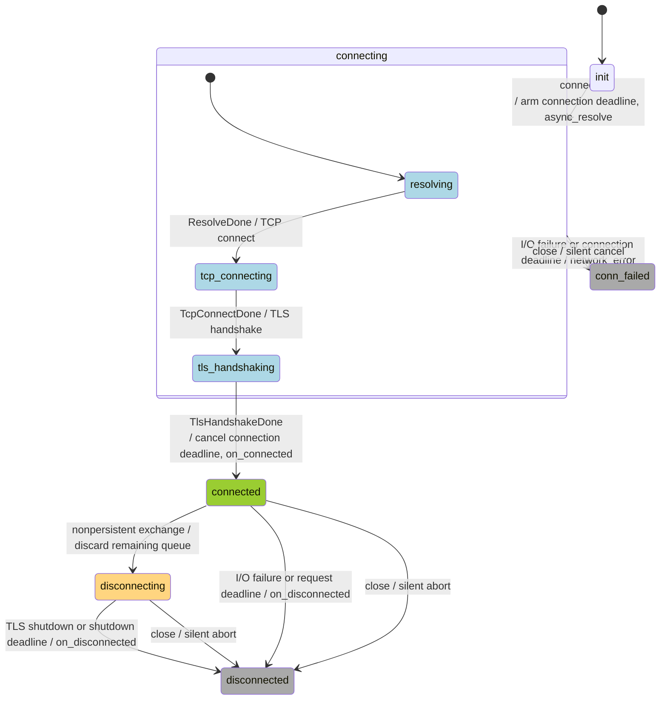

# HTTPS

`nom::https` is an asynchronous HTTP/1.1 client over verified TLS, exported by `nom.asio_comm`
from its `:https` partition. [https_example](../../apps/https_example/README.md) demonstrates
Assembly/relay integration and submitting another request from a response callback.

The current implementation and example are **complete**. Synchronous send, pipelining,
batching, the sending-workflow diagram and the broader exception audit are
[deferred follow-ups](../../src/asio_comm/current_work.md#https-timer-completion).

The constructor accepts an Asio executor and `nom::url` with an `https` scheme. The client owns
one origin, reuses its TLS context across connection attempts, verifies the trust chain and
hostname/IP, and uses SNI for DNS names. It uses the system/OpenSSL trust store; `SSL_CERT_FILE`
and `SSL_CERT_DIR` can select a local test CA. Verification cannot be disabled through the API.

```cpp
nom::https client(io.get_executor(), nom::url("https://example.com/info"));
// Supply on_connected, on_disconnected, network_error and response callbacks.
client.connect(delegate);
// From on_connected:
auto id = client.send(nom::http_request{.target = client.url().target()});
```

## Requests and responses

`http_request` owns `method`, encoded origin-form `target`, headers, body and `keep_alive`.
The methods are GET, HEAD, POST, PUT, DELETE, PATCH and OPTIONS. Boost.URL validates targets as
encoded absolute paths with an optional query, rejecting fragments, raw spaces and malformed
percent escapes. Header names must be HTTP tokens; values allow horizontal tab and opaque bytes,
but reject other control characters, including CR, LF and NUL. Callers can use `validate()`
without exceptions; diagnostics identify `/target`, `/headers/<index>/name` or `/headers/<index>/value`
without including header values.
`send()` validates and copies before accepting a request. The client supplies Host, HTTP/1.1
framing and a default User-Agent. Custom headers cannot override Host, Content-Length,
Transfer-Encoding, Connection, Upgrade, Expect or Trailer. Bodies remain opaque strings;
there is no JSON parsing, decompression, redirect following or protocol upgrade.

Every accepted send returns a nonzero, monotonically increasing `request_id` within that session.
The response callback is `(https&, request_id, const http_response&)`; the response contains
receipt time, numeric HTTP status, headers and an owned body. Its reference is valid only during
the callback; copy into application-owned storage to retain it. Non-2xx statuses are normal
HTTP responses, including rate-limit/error payloads; application code interprets them.

A bounded FIFO owns accepted requests. Only one request/response exchange is active at a time;
there is no HTTP pipelining. All writes are asynchronous. The active request/parser are retired
before delivering a response, and new work starts after delivery returns, so response handlers
can call `send()`, `close()`, `connect()` or destroy the client. Informational
responses are skipped until the final response; HEAD, chunked bodies/trailers and bodyless
statuses are handled by the parser. Over-read bytes are retained for subsequent parsing.
[Beast parser/read contract](https://www.boost.org/doc/libs/latest/libs/beast/doc/html/beast/ref/boost__beast__http__async_read/overload1.html).

## Lifecycle and events

The sequential stages inside `connecting` share the same `https_status::connecting` value.
The `Done` events denote successful completions; the group's failure, deadline and close
edges apply to every stage. One connection deadline covers the entire sequence.



The state machine belongs to the session; the `https` wrapper owns and replaces sessions.
Each command or completion handler uses one entry-state `switch`/`case`. The handler selects
the transition and explicitly names its emitted event; notification does not choose an event
based on state. Checks after a response delegate returns use `if` to account for re-entry.

| Event | Session handler | Valid active state | Action / failure outcome |
| --- | --- | --- | --- |
| Connect command | `connect` | `init` | Enter `connecting`, arm the connection deadline and start resolution. |
| Close command | `close` | Any | Preserve `init`/terminal states; otherwise enter `conn_failed` during setup or `disconnected` after connection. Cancel silently. |
| DNS completion | `on_resolve` | `connecting` | Start TCP connect; on error close to `conn_failed` and emit `network_error`. |
| TCP completion | `on_tcp_connect` | `connecting` | Start TLS handshake; on error close to `conn_failed` and emit `network_error`. |
| TLS handshake completion | `on_handshake` | `connecting` | Enter `connected` and emit `on_connected`; on error close to `conn_failed` and emit `network_error`. |
| Send command | `send` | `connected` | Validate, enqueue and start the next request when possible. Reject other states. |
| Request write completion | `on_request_written` | `connected` | Start reading the response; on error close to `disconnected` and emit `on_disconnected`. |
| Response completion | `on_response` | `connected` | Continue past informational responses or deliver the final response. Nonpersistent exchanges enter `disconnecting`; read/protocol errors close to `disconnected` and emit `on_disconnected`. |
| Connection deadline | `on_connection_deadline` | `connecting` | Close to `conn_failed` and emit `network_error`. |
| Request deadline | `on_request_deadline` | `connected` with an active request | Close to `disconnected` and emit `on_disconnected` identifying the timed-out request. |
| Shutdown deadline | `on_shutdown_deadline` | `disconnecting` | Close to `disconnected` and emit `on_disconnected`. |
| TLS shutdown completion | `on_tls_shutdown` | `disconnecting` | Close to `disconnected` and emit `on_disconnected`. |

Setup completions in `conn_failed`, and request/shutdown completions in `disconnected`, are
ignored after cancellation. Unexpected completion states trigger a debug assertion and are logged in
builds with assertions disabled. Connection, request and shutdown deadlines are distinct events
with dedicated handlers. Each operation arms the same `nom::timer` with its own callback;
these waits never overlap. Weak captures protect session lifetime, and the timer suppresses
canceled/superseded expiries.
Request-start, response-read and TLS-shutdown helpers are actions with fixed state preconditions.

`connect(delegate)` accepts an `https::https_delegate`, creates a fresh session and silently
cancels the previous one. Request IDs restart in the new session. No automatic retry/reconnect
occurs. On failure, unanswered IDs have unknown outcomes; a sent order may have reached the
server despite a missing response.
The terminal event ends all outstanding requests, rather than manufacturing individual responses.

`close()` immediately aborts silently, cancels deadlines/resolution, discards queued requests and
suppresses subsequent callbacks; destruction does the same. Repeated close calls are harmless.
Backend cleanup is best effort: exceptions are suppressed independently, remaining cleanup
continues, and terminal-state guards prevent late callbacks. Repeated calls retry cleanup.
The public interface has no graceful-shutdown operation, so stopping the client does not require
the application to keep handling outstanding requests or wait for a terminal event.

Graceful TLS shutdown is internal. When the request or response disables keep-alive, the final
response is delivered with status already `disconnecting`, so the callback cannot send more on
that connection. Remaining queued requests are discarded. After the callback returns, bounded
TLS shutdown starts and one `on_disconnected` follows, unless the callback explicitly closes,
replaces or destroys the client.

There is no background HTTP heartbeat or idle read. Idle peer closure is discovered on the next
exchange. Applications can use `nom::timer` to issue an endpoint-appropriate health request;
the library does not send unsolicited OPTIONS requests. Keep-alive preserves connection reuse,
not an application-level availability guarantee.

The client is movable but not copyable. Moving preserves the session, request IDs, pending queue,
callbacks and deadlines; subsequent callbacks receive the destination client. Move construction
leaves the source with a fresh `init` session, its original executor and URL, and default parameters.
It may throw while preparing that replacement, leaving the source unchanged. Move assignment is
`noexcept`: it transfers the source session and silently closes the destination's previous session,
which remains in the source with the destination's previous executor, URL and parameters. Both
moved-from clients remain reusable; self-move assignment does nothing.

All operations, moves and callbacks must share one serial execution domain. The executor context
must outlive the client and canceled handlers. Session-owned I/O resources remain alive until
outstanding handlers finish, including after destruction.
Exceptions must not escape delegates. Any exception escaping a transition propagates unchanged
to the application's outermost handler, which must log the fatal failure and exit. HTTPS makes
no recovery or session-state guarantee; do not resume event processing after such a failure.
Expected I/O errors and deadlines are handled within transitions and reported as events.
Validation/queue-limit errors reject a call before acceptance and can be handled by its immediate
caller; if they escape a delegate, the same fatal policy applies.

## Parameters and deadlines

Use `params()` to inspect, `https_params::validate()` for nonthrowing validation, and
`update_params()` before connecting or after closure. Updating during setup/connected/shutdown
throws; accepted values take effect on the next `connect()`.

| Parameter | Default | Meaning |
| --- | --- | --- |
| `connect_timeout_sec` | 30 | One DNS-through-TCP/TLS budget. |
| `request_timeout_sec` | 30 | Complete active write and final response, including intermediate 1xx replies. Queue waiting is excluded. |
| `shutdown_timeout_sec` | 5 | Internal TLS close-notify exchange after a complete nonpersistent HTTP exchange. |
| `max_response_body_size` | 1 MiB | Parsed response body cap, independent of headers and socket buffers. Larger snapshots require explicit configuration. |
| `max_request_body_size` | 1 MiB | Per-request body cap before acceptance. |
| `max_header_size` | 16 KiB | Request start-line/headers and response parser header cap. |
| `max_pending_requests` | 64 | Active request plus queued requests; overflow throws without disconnecting. |

All limits/timeouts must be positive. Queue capacity and per-request limits jointly bound accepted
request storage; a queue deadline and per-request cancellation are not provided. Deadlines use
[the generation-safe timer](timer.md). Failures during setup emit `network_error`; after connection,
I/O/parser failures and deadlines emit one `on_disconnected` with a textual diagnostic.

Truncated response bodies remain failures. A missing TLS close-notify is tolerated only during
shutdown after complete HTTP parsing, where it cannot validate an incomplete body.
[Beast TLS shutdown guidance](https://www.boost.org/doc/libs/latest/libs/beast/doc/html/beast/using_io/ssl_tls_shutdown.html).

## Validation

Unit tests cover request/configuration validation, queue-state preconditions, connection replacement,
cancellation during resolution, moves of initial/terminal sessions and moved-from reuse. Allocation
failure tests cover resolver cancellation during close, destruction and move assignment. The local
TLS suite checks moves during setup, pending requests, response callbacks and shutdown, deadline
preservation, callback ownership and silent replacement of an active destination. It also covers
response-callback re-entry, FIFO IDs and queue overflow, copied request storage, 1xx/chunked/HEAD parsing, internal shutdown after
request/response keep-alive ends, silent close with queued requests, callback close/destruction/reconnect
and fatal exception propagation to the application boundary, close/destruction during a pending
read, non-2xx responses, body/header limits,
truncation, upgrade rejection, TCP refusal, CA/hostname rejection, reset during a write,
connection/read/write/shutdown stalls, callback-visible states and failure diagnostics, and the
example's repeated GET workflow. Public exchange interoperability, HTTP/2,
proxy support, authentication/signing, and application heartbeat policies are outside this suite.
