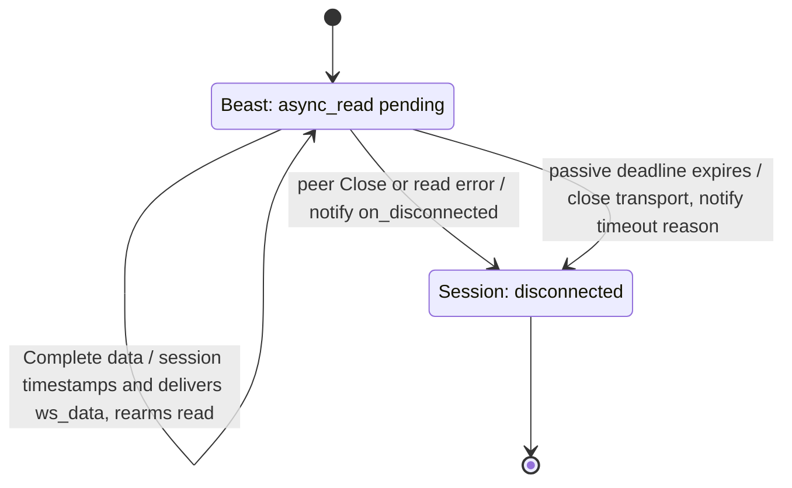
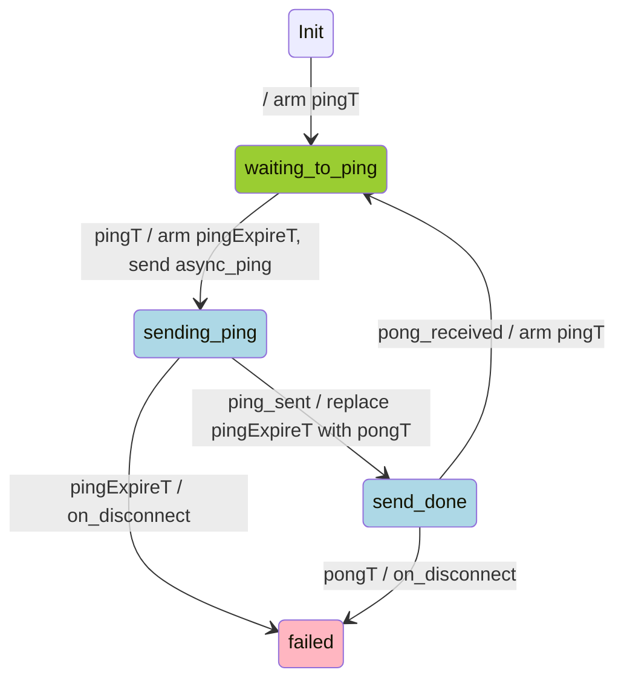

# WebSocket Ping and heartbeats

This document describes the control-Ping design implemented by `nom::web_socket`, its active
probe state machine, and the application heartbeat policies used by exchange adapters.
See [WebSocket](web_socket.md) for the connection lifecycle and general interface contract,
[ws_params](../../core/asio_comm/ws_params.cppm) for configuration, and the
[session implementation](../../core/asio_comm/web_socket.cpp) for event handling.

Transport activity, exchange heartbeat health, and useful application progress are separate
observations. A control Pong does not establish that subscriptions are working, and a healthy
private feed may have no order/account updates for a long time.

## Heartbeat responsibilities

| Pattern | Behavior | Responsibility |
| --- | --- | --- |
| Server control Ping | RFC Ping/Pong exchange, as used by Binance. | Beast automatically echoes the payload; optional `passive_ping` enforces server-Ping arrival. |
| Client control Ping | Periodic control probes. Ping write completion and Pong receipt are separate events. | Optional `active_ping` schedules probes and enforces send/Pong deadlines. |
| Client application ping | Text or JSON ping/pong, such as OKX's text `ping` / `pong`. | The adapter sends ordinary data messages and checks replies. |
| Server application ping | Timestamp/ID echo, such as HTX and LBank; HTX MD requires decompression first. | The adapter recognizes the request and replies on the same connection with the required value. |
| One-way heartbeat | Coinbase/Kraken-style notifications; no reply. | The adapter tracks heartbeat health separately from useful market data. |

Control frames and application messages follow different paths. Application heartbeats reach
subscribers as ordinary `ws_data`; the transport neither parses nor responds to them.

## Control Ping implementation

### Parameters

Both policies are independent and default to `std::nullopt`. Automatic replies to server Pings
remain enabled even when both are absent. Configure policies through `update_params()` before
connecting; settings cannot change during an active session.

| Setting | Meaning | Default when enabled |
| --- | --- | --- |
| `passive_ping` (`server_ping_watchdog`) | Require a server control Ping within `ping_timeout_sec` of handshake completion or the previous Ping. | 20 s |
| `active_ping.ping_period_sec` (`client_ping_probe`) | Wait before the first probe and after each completed probe. | 20 s |
| `active_ping.pong_timeout_sec` | Wait for a control Pong after successful Ping write completion. | 20 s |
| `async_operation_timeout_sec` | Bound each active Ping write, independently of its separate connection-setup use. | 30 s |

All durations must be positive. Sequential waits ensure probes cannot overlap even when the
Pong timeout exceeds the Ping period. These defaults are not exchange profiles: a passive
timeout must allow for the endpoint's server-Ping cadence and delivery delay.

### RFC and Beast behavior

RFC 6455 defines Ping/Pong as unfragmented control frames with at most **125 payload bytes**.
A Pong answering a Ping echoes its payload; unsolicited Pongs are allowed and need no reply.
Control frames can appear between fragments of a data message. The RFC prescribes no periodic
heartbeat interval and no JSON/text heartbeat format. [RFC 6455 §5.5](https://www.rfc-editor.org/rfc/rfc6455.html#section-5.5).

Beast handles incoming control frames during reads and automatically replies to Ping.
The control callback observes the frame; it does not replace that reply. A read must be
active, and the executor must keep running. Its internal coordination permits a read, a data
write, and a ping/pong operation to coexist under the documented operation rules; it does not
permit arbitrary concurrent operations. [Control frames](https://www.boost.org/doc/libs/latest/libs/beast/doc/html/beast/using_websocket/control_frames.html).

In the Boost **1.90.0** backend, `websocket/impl/read.hpp`
constructs the automatic Pong with the received payload; `impl/ping.hpp` coordinates its
write with other asynchronous writers. `async_ping` completes when the Ping is written or
fails, **not when a Pong arrives**. Do not initiate another explicit ping/pong operation until
it completes. [async_ping contract](https://www.boost.org/doc/libs/latest/libs/beast/doc/html/beast/ref/boost__beast__websocket__stream/async_ping.html).

Beast also supplies receive-idle timeouts and automatic idle probes. `web_socket` disables
both and owns the control-Ping timer/state transitions. A separate `nom::timer` bounds the whole
connection attempt; Beast supplies the close timeout after connection. TCP keepalive cannot replace exchange application
heartbeats. [Beast timeouts](https://www.boost.org/doc/libs/latest/libs/beast/doc/html/beast/using_websocket/timeouts.html).

### Scheduling and ownership

The [session implementation](../../core/asio_comm/web_socket.cpp) owns active/passive Ping
scheduling and deadlines; Beast reads control frames, writes Pings and automatically replies
to server Pings. Enabled policies and continuous reading start after a successful handshake
and an `on_connected` callback that leaves the session connected. Active probing and passive
monitoring run independently; they are not additional connection states.
The passive deadline is measured from handshake completion, then from each server control Ping;
data and Pongs do not refresh it.

### Incoming traffic and passive Ping monitoring

A missed passive deadline aborts the transport and emits one `on_disconnected` with
`Passive Ping timeout: no server Ping within N seconds`, without waiting for a close handshake.
Pings still receive automatic Pongs with monitoring disabled. Application heartbeats reach
the application as ordinary `ws_data`.

### Session cleanup

For both control-Ping policies, explicit `close()` closes the socket, cancels enabled timers and sets
`disconnected` without a delegate notification. Ping callbacks stop scheduling work
once the session is disconnecting or disconnected.

Peer Close, read errors and graceful shutdown also cancel active/passive Ping waits.
Late completions cannot rearm a terminal session or emit another terminal event.

Active/passive waits use `nom::timer`, which suppresses canceled and superseded completions.
An unexpected Boost timer error terminates the application with a fatal error message.

**Subscriber data freshness:** application heartbeats and subscription acknowledgements are
ordinary `ws_data` messages. The WebSocket layer cannot determine which messages represent
useful market updates, so it provides no receive-data watchdog. A subscriber can use
[`nom::timer`](timer.md), refresh it only on relevant updates, and own the
inactivity diagnostic and close/reconnect decision. Control-Ping policies remain independent.

## Active Ping state machine

When `active_ping` is present, the session runs this state machine while connected, scheduling
one probe at a time with a fresh payload. With the policy absent, no active probes run.
The session owns the statuses and deadlines; Beast performs `async_ping` and reports received
Pongs through the read operation's control callback.

Event mapping:
* `pingT` → `on_active_ping_timer` : it happens after a waiting period to send ping is over
* `pingExpireT` → `on_active_ping_expire_timer` : it happens when async ping operation hasn't finished in reasonable time
* `ping_sent` → `on_active_ping` : ping is sent
* `pongT` → `on_active_pong_timer` : it happens when pong hasn't been received in time
* `pong_received` → `on_active_pong` : pong was recieved (and connection is confirmed)

One timer serves three successive waits: `pingT` uses `ping_period_sec`, `pingExpireT` uses
`async_operation_timeout_sec`, and `pongT` uses `pong_timeout_sec`. Arm `pingExpireT` before
initiating `async_ping`; successful write completion replaces it with a fresh `pongT` wait.
Thus the send deadline includes time queued behind another control write. Send expiry selects
`failed` and disconnects with `Active Ping send timeout: write did not complete within N seconds`.
Pong expiry likewise selects `failed` and disconnects with `Active Pong timeout: no Pong within N seconds`.
As with other timers, execution requires the event loop to run.

Every received control Pong becomes `pong_received`, regardless of payload. The current
state decides its effect: `send_done` starts the next interval; `waiting_to_ping` and
`sending_ping` fail; `failed` ignores it. Pong and timeout events are handled in dispatch
order, without a separate receipt-time check in the Pong handler.
Data and server Pings cannot satisfy the probe.
A payload mismatch in `send_done` logs a warning with the expected and received payloads;
it does not change the transition.

**Completion policy:** timer events represent successful expiry of the current wait.
`nom::timer` suppresses canceled and superseded completions, including queued successes after
a long executor suspension. An unexpected Boost timer error terminates the application with
a fatal error message. Ping-write completions still ignore `operation_aborted`; other write
errors select `failed` and call `on_disconnect`. A blank condition means success/unconditional.
The terminal `failed` state ignores delivered events. Timer events marked impossible below
are guarded by an error log and a debug assertion; without assertions, they fail the probe
and disconnect. `on_disconnect` denotes transport abort followed by one `on_disconnected` event.

### `Init`

The automatic transition is `Init` → `waiting_to_ping`, with action `arm pingT`.

| Event | Condition | Next State | Action |
| --- | --- | --- | --- |
| auto event |  | `waiting_to_ping` | arm pingT |

### `waiting_to_ping`

| Event | Condition | Next State | Action |
| --- | --- | --- | --- |
| `pingT` | | `sending_ping` | Arm `pingExpireT`, then send `async_ping`. |
| `pingExpireT` | | | impossible: the send wait has not been armed |
| `ping_sent` | | `failed` | `on_disconnect` |
| `pongT` | | | impossible as `pingT` and `pongT` share the same timer |
| `pong_received` | | `failed` | `on_disconnect` |

### `sending_ping`

| Event | Condition | Next State | Action |
| --- | --- | --- | --- |
| `pingT` | | | impossible: the ping wait has already completed |
| `pingExpireT` | | `failed` | `on_disconnect` with a Ping send timeout reason. |
| `ping_sent` | `operation_aborted` | `sending_ping` | |
| `ping_sent` | Other error | `failed` | `on_disconnect` |
| `ping_sent` | | `send_done` | Replace `pingExpireT` with `pongT`. |
| `pongT` | | | impossible: the pong wait has not been armed yet |
| `pong_received` | | `failed` | `on_disconnect` |

### `send_done`

| Event | Condition | Next State | Action |
| --- | --- | --- | --- |
| `pingT` | | | impossible as `pingT` and `pongT` share the same timer |
| `pingExpireT` | | | impossible: the send wait was replaced by `pongT` |
| `ping_sent` | | `failed` | `on_disconnect` |
| `pongT` | | `failed` | `on_disconnect` |
| `pong_received` | | `waiting_to_ping` | Arm `pingT`. |

### `failed`

| Event | Condition | Next State | Action |
| --- | --- | --- | --- |
| `pingT` | | `failed` | Ignore. |
| `pingExpireT` | | `failed` | Ignore. |
| `ping_sent` | | `failed` | Ignore. |
| `pongT` | | `failed` | Ignore. |
| `pong_received` | | `failed` | Ignore. |

## Exchange heartbeat requirements

The following matrix retains the official API documentation review dated **2026-11-02**.
Authenticated connections and order submission were not tested; the date and source links
bound the exchange-specific claims below.

**Control** means RFC Ping/Pong frames; **application** means ordinary text/binary messages.
Intervals are server requirements or recommendations as marked, not library defaults.
“REST entry” describes the cited API family; it is not a claim about every product offered
by that exchange. A private order-update channel alone does not provide order entry.

| Exchange / API family | Market data | Private feeds | Order entry / differences |
| --- | --- | --- | --- |
| **Binance — Spot, USD-M** | Server **control** Ping: Spot every **20 s**, Pong within **1 min**; USD-M every **3 min**, Pong within **10 min**. Echo the payload. [Spot](https://github.com/binance/binance-spot-api-docs/blob/master/web-socket-streams.md#general-wss-information), [USD-M](https://developers.binance.com/en/docs/products/derivatives-trading-usds-futures/websocket-market-streams/Connect). | Spot supports user-data subscriptions on its WS API. USD-M listen keys need renewal within **60 min**, independently of socket Pongs. [Spot API](https://github.com/binance/binance-spot-api-docs/blob/master/web-socket-api.md), [USD-M lifecycle](https://developers.binance.com/en/docs/products/derivatives-trading-usds-futures/user-data-streams). | Both have WS order APIs. Spot retains **20 s / 1 min**, USD-M **3 min / 10 min** control policy. Connections have **24 h** lifetime. JSON RPC `ping` or listen-key renewal is distinct from control Pong. [USD-M WS API](https://developers.binance.com/en/docs/products/derivatives-trading-usds-futures/websocket-api-general-info). |
| **Coinbase — Advanced Trade** | Subscribe to application `heartbeats`: approximately **1 s**, no reply. Prevents quiet subscriptions closing after **60–90 s**. [Endpoints](https://docs.cdp.coinbase.com/coinbase-app/advanced-trade-apis/websocket/websocket-endpoints). | The separate user endpoint also supports `heartbeats`; subscribe within **5 s** of connecting. [Overview](https://docs.cdp.coinbase.com/coinbase-app/advanced-trade-apis/websocket/websocket-overview). | [REST entry](https://docs.cdp.coinbase.com/api-reference/advanced-trade-api/rest-api/orders/create-order); WS delivers order updates. This row does not prescribe behavior for Coinbase Exchange, International, or other API families. |
| **Upbit** | **120 s** idle limit; control Ping supported. Text `PING` is an alternative that starts `{"status":"UP"}` notifications every **10 s**, rather than a single Pong. [Guide](https://global-docs.upbit.com/reference/websocket-guide). | Authenticated private endpoint follows the connection guide; order events can legitimately be absent. [MyOrder](https://global-docs.upbit.com/reference/websocket-myorder). | [REST entry](https://global-docs.upbit.com/reference/api-overview); WS subscriptions provide market/account events. |
| **OKX — v5** | Application text `ping` → `pong`: after receive silence of **N < 30 s**, send Ping, then reconnect if no Pong within N. [Connection rules](https://www.okx.com/docs-v5/en/#overview-websocket-connect). | Same connection rule on private/business connections; authentication and subscriptions are separate from heartbeat. | WS `order` on authenticated private connection; same text heartbeat. [Place order](https://www.okx.com/docs-v5/en/#order-book-trading-trade-ws-place-order). |
| **Bybit — v5** | Application JSON `op:ping`, recommended every **20 s**. Response shape varies by endpoint. [Connect](https://bybit-exchange.github.io/docs/v5/ws/connect). | Private and trade endpoints support configurable `max_active_time` (**30–600 s**); default idle allowance is **10 min**. | Separate WS trade endpoint; JSON ping/pong also applies, with its own response envelope. [Trade guide](https://bybit-exchange.github.io/docs/v5/websocket/trade/guideline). |
| **Bitget — UTA** | Text `ping` → `pong` every **30 s** recommended; disconnect after **2 min** without Ping. [Quick start](https://www.bitget.com/docs/uta/quick-start). | Same policy on UTA private connection. | WS `op:trade`, including `place-order`, uses the private connection. Acceptance acknowledgement is separate from execution updates. [Order channel](https://www.bitget.com/docs/uta/websocket/private/Place-Order-Channel). |
| **Gate — Spot v4 / Futures** | Server **control** Ping requires Pong. Optional application `spot.ping` / `futures.ping` provides additional checks; no fixed cadence is assumed here. [Spot](https://www.gate.com/docs/developers/apiv4/ws/en/#application-ping-pong), [Futures](https://www.gate.com/docs/developers/futures/ws/en/#ping-and-pong). | Authenticated subscriptions share the corresponding family's connection rules. | WS `spot.order_place` / `futures.order_place` supported; use the same family-specific heartbeat, not a universal JSON payload. [Spot entry](https://www.gate.com/docs/developers/apiv4/ws/en/#order-place), [Futures API](https://www.gate.com/docs/developers/futures/ws/en/). |
| **KuCoin — Classic / UTA** | Classic uses JSON `type:ping`; read `pingInterval` and `pingTimeout` from token/endpoint discovery. UTA uses `op:ping` and welcome-message settings. [Classic](https://www.kucoin.com/docs-new/websocket-api/base-info/introduction), [UTA](https://www.kucoin.com/docs-new/websocket-api/introduction). | Each connection owns its negotiated schedule. Current examples show **18 s / 10 s**; do not hard-code them as universal constants. | UTA provides a WS trade connection. Its heartbeat envelope differs from Classic; negotiated settings belong to that adapter instance. |
| **MEXC — Spot v3 / Futures** | Spot JSON `method:PING` → `msg:PONG`; inactive subscriptions can close after **60 s**, and an unsubscribed connection after **30 s**. Data is Protobuf. [Spot streams](https://www.mexc.com/api-docs/spot-v3/websocket-market-streams), [Ping format](https://mexcdevelop.github.io/apidocs/spot_v3_en/#ping-pong-mechanism). Futures uses lowercase `method:ping`, recommended **10–20 s**, closing after **60 s** without Ping. [Futures commands](https://www.mexc.com/api-docs/futures/websocket-api/command-details-for-data-exchange). | Spot listen keys additionally expire after **60 min** without renewal; connection lifetime **24 h**. [User streams](https://www.mexc.com/api-docs/spot-v3/websocket-user-data-streams/). | [Spot REST entry](https://www.mexc.com/api-docs/spot-v3/spot-account-trade/new-order), [Futures trade API](https://www.mexc.com/api-docs/futures/trade/); private push streams are distinct from submission. |
| **HTX — Spot / derivatives** | Spot server JSON `ping` timestamp every **5 s**; reply with matching `pong`; two missed heartbeats disconnect. MD arrives gzip-compressed in binary messages. [Spot heartbeat](https://huobiapi.github.io/docs/spot/v1/en/#heartbeat-and-connection). | Spot `/ws/v2` uses uncompressed `action:ping`, nested `data.ts`, approximately **20 s**; reply `action:pong`. Derivatives private feeds use an `op:ping` / `op:pong` envelope. [Spot private](https://huobiapi.github.io/docs/spot/v1/en/#websocket-account-and-order), [Derivatives](https://huobiapi.github.io/docs/dm/v1/en/#websocket-heartbeat-and-authentication-interface). | Order submission is REST in these documented families; WS account/order sections describe updates. Do not reuse the MD heartbeat classifier for private messages. |
| **Crypto.com — Exchange v1** | Server application `public/heartbeat` every **30 s**; send `public/respond-heartbeat` with the same ID within **5 s**. [WS specification](https://exchange-developer.crypto.com/exchange/v1/docs/api/websocket-single-page/). | Same protocol on `/user` as `/market`. | WS `private/create-order` uses `/user`; keep heartbeat replies prompt even during order bursts. Cancel-on-disconnect is a separate trading policy. [WS methods](https://exchange-developer.crypto.com/exchange/v1/docs/api/websocket-single-page/). |
| **Kraken — Spot v2 / Futures** | Spot emits an application heartbeat about every **1 s when other updates are absent**, after subscribing; no reply. Optional JSON `method:ping` returns Pong. [Heartbeat](https://docs.kraken.com/exchange/api-reference/spot-websocket-v2/heartbeat), [Ping](https://docs.kraken.com/exchange/api-reference/spot-websocket-v2/ping). | Spot authenticated subscriptions have the same application Ping option. Futures separately requires a Ping at least every **60 s**; its official client demonstrates **control** pings. [Futures guide](https://docs.kraken.com/exchange/guides/futures/websockets), [client](https://github.com/CryptoFacilities/WebSocket-v1-Python/blob/master/cfWebSocketApiV1.py). | Spot v2 supports authenticated WS [add_order](https://docs.kraken.com/exchange/api-reference/spot-websocket-v2/add_order). Do not infer Futures WS order-entry support from the streaming guide. |
| **LBank — Spot v2** | Server JSON `action:ping` includes an identifier; reply `action:pong` with it within **1 min**. Client-initiated application Ping is also supported. [Specification](https://www.lbank.com/docs/). | Same WS family; additionally renew `subscribeKey` before its **60 min** expiry. | REST entry; WS `orderUpdate` is notification. [Trading and private streams](https://www.lbank.com/docs/). |
| **XT.com — Spot / Futures** | Spot text `ping` → `pong`, with **1 min** maximum silence between Pings. Futures requires text Ping within **30 s**. [Spot](https://doc.xt.com/docs/spot/WebSocket%20Public/Heartbeat), [Futures](https://doc.xt.com/docs/futures/WebsocKetV2/General_WSS_information). | Futures private repeats the **30 s** rule. Spot private heartbeat cadence is **not explicit in the reviewed pages**; its access token lasts **2 days**. [Futures private](https://doc.xt.com/docs/futures/UserWebsocket/General_WSS_information), [Spot private](https://doc.xt.com/docs/spot/WebSocket%20Private/GeneralWSSInfo), [token](https://doc.xt.com/docs/spot/WebSocket%20Private/GetWsToken). | [Spot REST entry](https://doc.xt.com/docs/spot/Order/SubmitOrder). Confirm Spot private heartbeat behavior before adopting the public interval. |
| **bitFlyer — Lightning JSON-RPC** | Raw JSON-RPC over WebSocket is available. The reviewed official pages do **not specify a numeric heartbeat cadence**. Keep RFC replies enabled; any client probe schedule is our policy pending verification. [Realtime API](https://bf-lightning-api.readme.io/docs/realtime-api), [JSON-RPC](https://bf-lightning-api.readme.io/docs/endpoint-json-rpc). | Authenticate and subscribe to private channels over JSON-RPC. Socket.IO is an alternative protocol with additional framing, not interchangeable with raw WS. | [HTTP order entry](https://lightning.bitflyer.com/docs#send-a-new-order); private WS channels deliver order events. |
| **Deribit — JSON-RPC v2** | Enable `public/set_heartbeat`, interval **10–300 s**. Informational heartbeat needs no reply; `test_request` requires `public/test`. Control Ping/Pong does **not** satisfy this application mechanism. [Heartbeat contract](https://docs.deribit.com/api-reference/session-management/public-set_heartbeat). | Same connection mechanism before/after authentication; client JSON activity affects the timer. | WS [private/buy](https://docs.deribit.com/api-reference/trading/private-buy) and corresponding trading methods. Heartbeat disconnect can cancel orders if cancel-on-disconnect was enabled. |

Two details affect adapter behavior:

- **Deribit:** the detailed method contract distinguishes no server output for `interval`
  (informational heartbeat) from no client JSON input for `interval + 500 ms` (test request).
  Continued client silence closes at `2 × interval + 500 ms`. Sending control Pongs cannot
  prevent that application timeout. [Detailed contract](https://docs.deribit.com/api-reference/session-management/public-set_heartbeat).
- **Rate/lifetime budgets:** heartbeat messages can consume the same incoming-message budget
  as subscriptions, e.g. Binance Spot's **5 messages/s** includes control Ping/Pong and JSON.
  Heartbeats also do not extend a mandatory connection lifetime or renew a private-feed lease.
  [Binance limits](https://github.com/binance/binance-spot-api-docs/blob/master/web-socket-streams.md#websocket-limits).

## Application heartbeat and subscriber integration

| Layer | Owns |
| --- | --- |
| `web_socket` session | RFC framing/replies, continuous reading, optional control-heartbeat policies, setup/close deadlines, terminal cleanup and diagnostics. |
| Exchange connection adapter | Application heartbeat encoding/replies, negotiated intervals, authentication, subscription acknowledgement, data-freshness timers, token renewal and reconnect readiness. |
| MD/order consumer | Per-channel/symbol freshness, sequence continuity, order-response deadlines and reconciliation of unknown outcomes. |

Application-only protocols leave both control policies absent. One-way application heartbeats
also belong to the adapter; they cannot refresh `passive_ping`, which observes control Pings only.
The [example apps](../../apps/README.md) show exchange-specific integration; their configured
policies do not replace the endpoint requirements above.

Application heartbeats use ordinary `send()` and receive events, with adapter-owned timers and
bounded string recognition for known envelopes. `web_socket` supplies no JSON parser or exchange
message policy. Adapters match required IDs/timestamps, tolerate documented whitespace/order
variation, and avoid classifying arbitrary messages by a loose search for `ping`/`pong`.
Replies take priority over expensive downstream processing.

Runtime-negotiated settings, such as KuCoin welcome values, belong to the adapter instance.
They do not require changing `ws_params` on an active session. A shared application-heartbeat
helper remains optional future work once concrete adapters establish common needs.

HTX gzip and MEXC Protobuf require adapter decoding. Gzip here is application compression,
separate from WebSocket compression; decoded output needs its own size bound. `ws_data`
currently supplies borrowed bytes without text/binary metadata. Adding that metadata is
separate interface work; the borrowed-payload lifetime contract still applies. Public control
observation and manual Ping sending are also outside the current interface.

### Sending and order execution

`send()` blocks and reports local write completion. A blocking write or long delegate callback
can delay reads, automatic Pongs, application replies and timers. Bounded response times under
a stalled peer may require an owned, bounded asynchronous send path; that remains separate
work, with [WS-03](../../core/asio_comm/ws_current_work.md#ws-03) closed as unconfirmed.
Queue acceptance, local write completion and exchange acknowledgement are distinct events.
Data/control/close operations need coordination; prioritizing a heartbeat between queued
messages cannot preempt bytes already being written.

An order timeout or reconnect leaves a potentially unknown outcome. The order adapter reconciles
by client/order ID instead of replaying automatically, and explicitly chooses cancel-on-disconnect.
Private-feed lease expiry and order-acknowledgement deadlines also belong above the transport.

### Data freshness

Subscribers classify useful updates and refresh their own [`nom::timer`](timer.md) only for those
messages, excluding application heartbeats and acknowledgements. Each subscriber owns the
inactivity diagnostic and close/reconnect decision. A busy symbol must not hide another
subscription's stalled data. Heartbeat health and a quiet private feed are separate concerns.
The broader [execution abstraction](../../core/asio_comm/current_work.md) remains separate work.

## Validation and implementation boundaries

Active/passive control Pings are **DEV-DONE/LIVE-TEST-PENDING**. Local TLS tests cover deadline
expiry, Pong event dispatch, blocked sends/recovery, cancellation, move and reconnect safety.
Both WebSocket and HTTPS use the [generation-safe timer](timer.md); canceled and superseded
waits cannot re-enter their protocol state machines.

Exchange requirements in the matrix describe API contracts, not validation of every private
feed or order API. Each application profile requires endpoint-specific tests for text ping/pong,
timestamp/ID echo, server challenges, one-way notifications, binary/compressed messages and
negotiated intervals as applicable. Healthy private-feed silence needs separate treatment from
missing market data.

Live/network-loss checks, subscription bursts, heartbeat delays behind large/stalled writes,
rate limits, token renewal and planned server disconnects remain validation boundaries.
Simulated order replies suffice for heartbeat tests; live orders are unnecessary. Connection
deadline coverage and live/network-loss validation are tracked in
[WS-06](../../core/asio_comm/ws_current_work.md#ws-06).
