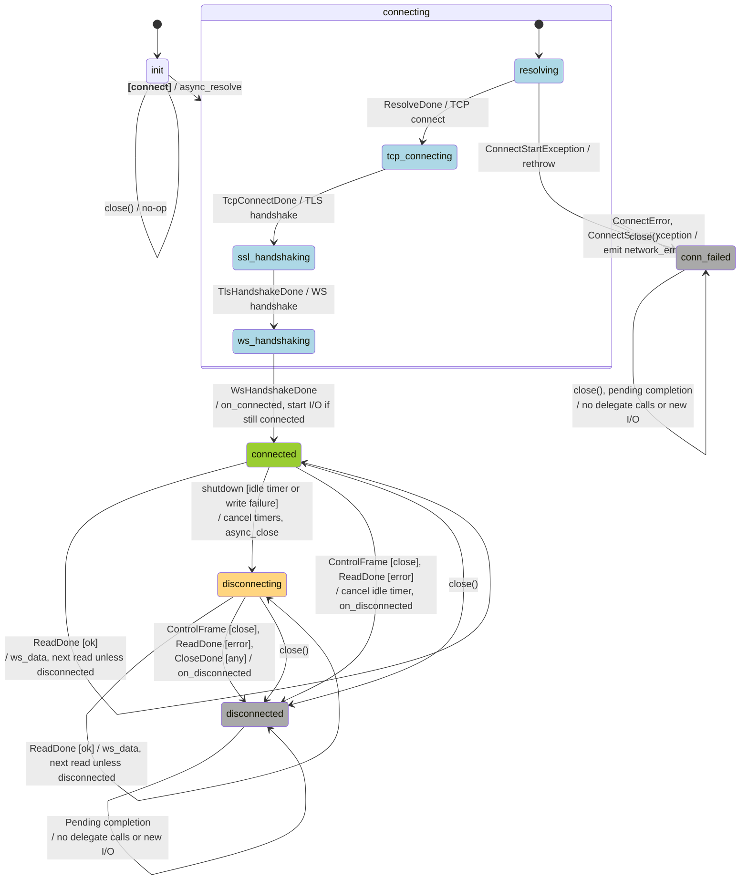

# WebSocket

This records the public [module interface](../core/asio_comm/web_socket.cppm) and
the [session implementation](../core/asio_comm/web_socket.cpp). The diagram describes
one `web_socket::session`. The wrapper constructs its first session eagerly; the first
`connect()` starts that session, and later attempts close and replace the previous session. Usage examples are in the [WebSocket example README](../apps/web_socket_example/README.md).
Usage constraints, deferred work and validation coverage follow the event descriptions.
The diagram assumes the existing contract of serialized calls and nonthrowing delegates.
`web_socket` holds the session and forwards commands and queries. Its `connect()` only checks
whether the session is still in its initial `init` state; otherwise it closes and replaces it.
It does not dispatch session states or depend on specific post-close states. The state machine
and its transition rules belong to `session`.

## State diagram

Top-level state captions show `status_`. The `connecting` group expands its sequential operation
stages; these are not additional `ws_status` values. A fresh session starts in `init`;
`session.connect()` enters `connecting` before starting resolution. Terminal sessions are never reused.
Ownership and destruction are described below; callback guards use `status_` only.
Each stateful session operation or handler uses one `switch`/`case` for entry-state dispatch.
Mid-function state checks, such as guards after delegate calls, use concise
`if (status_ ...)` conditions. A switch on control-frame kind handles a separate input.
Edge labels use **event [condition] / action**; entering a top-level state implies its stored status.
Multiple events on one transition are separated by commas; `/` separates an event from its actions.
Transitions from the `connecting` group apply to every stage within it.
All `close()` edges share the cleanup actions described below the diagram.

- `disconnecting` reports that an internal graceful close has started. `is_connected()` is
  false and `send()` returns false. Successful timer callbacks stop,
  and callers prevent further `shutdown()` requests. Pending reads can still deliver data.
- The wrapper always holds a session and reports that session's status and identity. Before
  its first attempt it reports `init`. Closing an unused client is a no-op and retains its
  identity; the first `connect()` starts that session. Reconnect closes the old session and
  constructs a fresh `init` session with a new identity before starting it.
- `close()`, called by **[close]**, replacement **[connect]**, or **[destroy]**, is a no-op in
  `init`. Otherwise it maps `connecting` to `conn_failed` and `connected`/`disconnecting` to
  `disconnected`, and preserves an existing
  terminal status. Selecting `conn_failed` releases setup storage and cancels pending resolution.
  It then independently disables Beast handshake/close timeouts and attempts TCP close and
  timer cancellation.
  Cleanup exceptions are suppressed; no event is delivered. The wrapper retains its session
  and identity after close, until reconnect or destruction.
- `parent_` retains the holder's address in every state. The wrapper may still own a terminal
  session for status and identity queries. Reaching a terminal state does not destroy the
  object: pending handlers may retain shared ownership. Their entry-state switches suppress
  further work and notifications in terminal states, without dereferencing the parent.
  After owner destruction the retained address must not be used. Destruction of the session
  occurs when the last shared owner releases it.
- `conn_failed` is terminal for the same session. Setup failure or cancellation before connection
  selects it; further connection completions do nothing, `send()` rejects writes, and repeated
  `close()` preserves it. Reconnect replaces the session rather than resetting that terminal state.
  Complete transport cleanup remains a separate concern.
- The resolver and HTTP Host-header string belong to a uniquely owned setup object. It is
  allocated inside `connect()` after entering `connecting` and released when status becomes
  `connected` or `conn_failed`, before notification. Terminal completion guards run before accessing setup storage, so
  canceled operations can finish after it is released. An unused `init` session has no setup
  allocation; reconnect starts with fresh setup storage.
- `shutdown()` is an internal helper that requires connected status. Any other status is
  a precondition violation: assert, or log and return when assertions are disabled. Pending attempts are
  cancelled through `close()`. Every transition to `conn_failed` or `disconnected` uses
  `set_status<NewStatus>()`, which updates status before notification or further error construction.
  Debug checks require transitions to advance in enum order; selecting `init` after construction
  is rejected at compile time. The parent link does not encode session status.
- The first close-frame, read-error or close-completion handler that sees `connected` or
  `disconnecting` sets `disconnected` and emits `on_disconnected`. Later handlers do not emit another terminal event.
  A `CloseDone` error does not select `ConnFailed` on this path.
- Self-loops mean no change to `status_`. Other unchanged-state cases are listed below.
  Read, control-frame, ping and close completions stop when disconnected.
  Delegate calls are synchronous; `close()` or reconnect in a
  callback sets the old session to disconnected. Read handlers recheck for disconnection,
  and handshake handlers require connected status before starting I/O.

## Events

Names such as `ResolveDone` label outcomes handled by existing callbacks, not new C++ event types.
The four connection-chain `Done` events denote success; failures are represented by `ConnectError`.
Other completion events can carry either result: `ok` means a clear error code, and `error`
means a nonzero error code. Completion handlers can arrive after cancellation, including
with success if already queued.

### Client commands and lifetime

- **Move construction** transfers the session with its delegate, parameters, endpoint, and backend state
  to the destination and updates the session's owner. The source receives a fresh `init`
  session for the same endpoint, with default parameters and no delegate. Both wrappers retain
  valid, always-present sessions. Preparing the replacement can allocate and throw; the source
  remains unchanged if that preparation fails. Move construction is therefore not `noexcept`.
- **Move assignment** is `noexcept`: exchange the two wrappers' state and swap the sessions'
  parent pointers, then call `other.close()` on the former destination session. Swapping is
  independent of session status. The source receives the destination's former state after close;
  it remains usable, including for a new `connect(callbacks)`. Old destination completions retain
  their terminal session and cannot notify either wrapper. Self-move is a no-op. Terminal
  sessions retain their status and acquire their new holder's address. TLS contexts keep their heap addresses.
- **Copying** remains disabled: duplicating ownership of an active connection has no defined
  meaning. The delegate travels with its session during moves; user captures retain their values.
- **`[connect]`** — `web_socket::connect(callbacks)`: use the eagerly created session directly
  while it is still in `init`; otherwise close and replace it with a fresh session. Set the
  session's delegate and forward `connect()` to the selected session. A replacement copies
  the callbacks before the old session is released, including for `connect(client.callbacks())`.
  The wrapper does not inspect the old session's state after close. Read the owner's `ws_params`
  through `parent_`; parameters, including headers, persist across reconnects and are not copied
  into the session.
  The session's `connect()` dispatches through `switch (status_)`: `init` enters `connecting`,
  constructs the enabled timers, allocates setup storage, and starts DNS resolution; other
  states log an error and do nothing. Terminal sessions are never reused. If timer construction,
  setup allocation or DNS initiation throws, the session
  becomes `conn_failed` and the original exception propagates to the caller; no delegate event
  is emitted. If replacing the delegate
  or allocating the next session throws, the existing session remains installed with its
  current status. Construction of the wrapper itself now includes allocation and construction
  of the first session and TLS/WebSocket stream. Optional timer objects are constructed by `connect()`.
- **`[close]`** — `web_socket::close() noexcept`: no-op in `init`; otherwise select
  or preserve the appropriate terminal state, then independently disable Beast handshake/close
  timeouts and attempt TCP close and cancellation of each application timer. Setup destruction
  cancels resolution while aborting a connection attempt. Cleanup exceptions are suppressed without
  logging or delegate calls; a failed cancellation may leave an operation pending until it
  completes naturally. Its completion cannot notify the delegate. There is no final event or
  buffered-data flush. Repeated close preserves both the terminal status and session identity.
- **`[destroy]`** — owner destruction calls `close()` and releases its shared ownership.
  Pending handlers keep the terminal session, its delegate, and the delegate's captures alive
  until their completion or destruction.
  They check status before accessing the retained parent address.
  `shared_ptr` is required by this lifetime scheme: substituting `unique_ptr` and raw captures
  would destroy the session while queued handlers still reference its transport or buffers.
  Unique ownership would require a separate operation-state lifetime or an explicit drain
  contract before reconnect/destruction; neither is provided by this API.
- **`[send]`** — blocking write returning a `[[nodiscard]]` bool. A complete write returns true;
  short writes and error-code failures request `shutdown()` and return false. The wrapper
  delegates directly to its always-present session: connected writes; every other state logs
  a warning and returns false without writing.
- **`[update_delegate]`** — replace the current session's delegate; no lifecycle transition.
  `callbacks()` borrows that session's delegate. A borrowed reference remains valid while
  its session lives; reconnect installs a different session with its own callback storage.
- **Parameter updates** — `params()` returns `const ws_params&`. `update_params(const ws_params&)`
  replaces the whole configuration only in `init`, `conn_failed`, or `disconnected`. It first
  calls `ws_params::validate()` and throws `std::invalid_argument` with the same diagnostic for
  invalid values. A valid update during `connecting`, `connected`, or `disconnecting` throws
  `std::logic_error`. Validation precedes the state check. The wrapper owns all update logic;
  the session continues reading its parent's settings, which remain fixed throughout an attempt.
  Validation, state rejection, and copy/allocation failure leave settings, status, session identity,
  and pending operations unchanged. Copying a candidate and swapping it into place provides the
  commit guarantee, including `update_params(client.params())`. Calls must remain serialized.
  Accepted settings persist across reconnects; `update_params({})` restores defaults while inactive.

`ws_params::validate() const` returns `std::expected<void, std::string>`. It is independent of
session state and performs no I/O or mutation. Success is an empty expected value; failure is
the first field diagnostic, such as `/receive_watchdog/timeout_sec must be positive` or
`/headers/1/name duplicates an earlier header`. Error-string allocation can still throw.

| Parameter | Validation |
| --- | --- |
| `async_operation_timeout_sec` | Positive. |
| `receive_watchdog` | Optional `receive_data_watchdog`, absent by default. When enabled, `timeout_sec` must be positive and defaults to 20. Independent of Ping settings and setup timeout. |
| `passive_ping` | Optional `server_ping_watchdog`; `ping_timeout_sec` must be positive. Defaults to absent. Deadline enforcement is pending. |
| `active_ping` | Optional `client_ping_probe`; `ping_period_sec` and `pong_timeout_sec` must be positive. Defaults to absent. Presence enables periodic Pings; Pong deadline enforcement is pending. |
| Socket buffer sizes | Between 1 and `INT_MAX`; OS acceptance is determined when socket options are applied. |
| `max_message_size` | Incoming-message byte limit in `[1, UINT_MAX]`; defaults to 16 MiB. Applies to the entire message across fragments, independently of socket buffers. |
| `agent_name` | Contains non-whitespace content, valid HTTP field-value characters, and a supported field length. |
| Header names | Nonempty HTTP tokens, within the backend limit, unique under case-insensitive comparison. |
| Header values | Empty values are allowed; reject CR, LF, NUL, other controls except HTAB, and DEL. Values must fit the backend limit. |

The current backend supports at most 65,533 bytes for a field name or value, including
`agent_name`. `Host`, `Connection`, `Upgrade`, `Sec-WebSocket-Key`, `Sec-WebSocket-Version`,
`Sec-WebSocket-Accept`, `Sec-WebSocket-Extensions`, `Content-Length`, and `Transfer-Encoding`
are managed handshake/framing fields and cannot be overridden. `User-Agent` remains an allowed
override of `agent_name`; `Sec-WebSocket-Protocol` is not reserved by this validator.
Header syntax follows the [HTTP field rules](https://www.rfc-editor.org/rfc/rfc9110.html#section-5).

`max_message_size` is applied before the WebSocket handshake on each attempt. A message whose
declared or accumulated length exceeds it fails the read without delivering a partial
`ws_data` event; the peer receives WebSocket close code 1009. The application receives
`on_disconnected` with `Incoming WebSocket message exceeds max_message_size=N bytes` in
`reason`. The TLS adapter preserves Beast's WebSocket result and retains any TLS teardown
error separately; it is appended as `; TLS shutdown error: ...` instead of replacing the
protocol diagnostic. Close-write failures can still be reported as transport errors before
teardown begins. Zero is rejected rather than
requesting the backend's unlimited mode. This setting does not limit outgoing messages or total
process memory, and the receive buffer can retain allocated capacity after consuming a message.
See [Beast's message-size option](https://www.boost.org/doc/libs/latest/libs/beast/doc/html/beast/ref/boost__beast__websocket__stream/read_message_max/overload1.html)
and the [Spot symbol provider](../apps/binance/binance_spot_symbol_provider/README.md).

### Connection completions

These handlers dispatch through `switch (status_)`: connecting handles the current stage,
`conn_failed` ignores its completion, and all other states assert, or log and return when
assertions are disabled. `connect()` sets connecting before starting DNS resolution; each
successful stage starts the next operation without changing that status. Connection stages
run sequentially, with only one stage pending at a time. A connection error sets `conn_failed`
and ends the chain. Cancellation through `close()`, reconnect, or owner destruction also sets
`conn_failed` before cancelling setup operations, so queued completions stop without checking
`parent_`. This includes successful completions already queued when cancellation occurs.
The synchronous socket setup and handshake request decorator assert connecting.
Setup and operation-initiation exceptions inside these completion handlers select `conn_failed`
in the catch body. A local notification lambda invokes the session's delegate and emits
`network_error` directly from the catch. The event identifies the failed stage and carries
`std::exception::what()`, or `Unknown exception` for other exception types. The original setup
exception is suppressed. Message copying and notification happen after the status change; exceptions
from a catch body propagate instead of being caught by another handler of the same try block.
Ordinary completion errors use the same notification lambda. The wrapper continues owning the
terminal session until reconnect or destruction.

- **`ResolveDone`** — `on_resolve`: successful DNS resolution starts TCP connect.
- **`TcpConnectDone`** — `on_connect`: successful TCP connection and SNI setup start the
  TLS handshake.
- **`TlsHandshakeDone`** — `on_ssl_handshake`: successful TLS handshake starts the
  WebSocket handshake with the owner's current `params().headers` and `agent_name`.
- **`WsHandshakeDone`** — `on_handshake`: successful WebSocket handshake records activity, sets
  `connected` and emits `on_connected`. If still connected after the delegate returns, start
  the read/control callbacks and the independently optional idle/Ping timers. Calling `close()` or
  triggering a write-failure shutdown from the delegate prevents this work from starting.
- **`ConnectError`** — diagram shorthand for an error in any of those four completions, or SNI
  setup failure inside `on_connect`. Emit `network_error`; no automatic `close()`.
- **`ConnectStartException`** — timer construction, setup allocation or DNS initiation throws
  during the caller's `connect()` invocation.
  Set `conn_failed` and rethrow to that caller; no delegate event or automatic `close()`.
- **`ConnectSetupException`** — setup or operation initiation throws inside `on_resolve`,
  `on_connect`, `on_ssl_handshake`, or the connecting-phase setup in `on_handshake`.
  Set `conn_failed`, notify through `network_error`, and finish the handler without rethrowing the
  reported exception. No automatic `close()`. Operations started after entering connected
  use the existing behavior and need a separate exception-cleanup policy.

### Read, control-frame and close completions

- **`ReadDone(ec, bytes_transferred)`** — `on_receive`: complete message or read error.
  Dispatch through `switch (status_)`: connected and disconnecting share the read handler;
  disconnected completions are ignored. Other states assert, or log and return when assertions
  are disabled. Success updates receive activity, emits `ws_data`, consumes the buffer and
  rearms unless disconnected during the delegate call. Error cancels the idle timer, sets
  disconnected and emits `on_disconnected`; remaining buffered bytes are not delivered.
- **`ControlFrame(kind)`** — `on_control`: `ping`, `pong` or `close`, dispatched through
  `switch (status_)`. Connected and disconnecting share frame handling: the handshake started
  reading, and pending operations may still process control frames after `shutdown()` starts.
  Ping updates receive activity; pong does so only when outbound pings are enabled. Close cancels
  the idle timer, sets `disconnected` and emits `on_disconnected` (`Closed by server`).
  Disconnected callbacks are ignored after `close()`, a prior peer close, a read error, or
  `on_shutdown()`. Other states assert, or log and return when assertions are disabled.
- **`CloseDone(ec)`** — `on_shutdown`: local WebSocket close result, successful or not.
  Dispatch through `switch (status_)`. The disconnecting case sets `disconnected` and
  emits `on_disconnected` with an empty or error reason. The disconnected case does nothing;
  all other states assert, or log and return when assertions are disabled.

Valid `ReadDone` entry states and their origins:

- `connected`: `on_handshake()` set connected and started the first read; subsequent successful
  reads rearm the loop while no close has started.
- `disconnecting`: `shutdown()` set disconnecting after an idle timer expiry/error or write failure,
  before a pending read completion was delivered. A `ws_data` delegate can also cause a write
  failure; after it returns, the read handler rearms while disconnecting. Completed messages
  are still delivered in this state.
- `disconnected`: `close()` (including reconnect/destruction), the peer-close control callback,
  or `on_shutdown()` changed the state before the pending read completion was delivered.
  Ignoring it avoids callbacks after close or owner destruction and duplicate terminal events.

`ReadDone` cannot occur while init, connecting or conn_failed: reads start only after a successful
handshake, and a session is never reused. A previous read error does not produce another read
completion: only one read is outstanding, and its error path does not rearm. The switch's
default branch expresses the entry-state invariant.
`CloseDone` cannot arrive while init, connected, connecting or conn_failed: `shutdown()` sets
disconnecting before starting the operation. The switch's default branch rejects these
states and unknown status values.

### Timers and internal close request

The session holds optional idle and Ping timer objects. `connect()` constructs each only
when its policy is enabled; the waits start after a successful handshake. Cancellation
checks whether the timer exists. Parameters can still be changed before the first connect.

- **`PingTimerDone(ec)`** — `on_ping_timer`: a timer using `params().active_ping->ping_period_sec`
  (20 seconds by default) when `active_ping` is present, dispatched through `switch (status_)`.
  Connected handles the timer started after handshake or rearmed after
  a previous ping completion: success starts one ping send. Disconnecting handles a canceled or
  queued wait after `shutdown()`; disconnected handles waits delivered after `close()`, peer
  close, a read error, or `on_shutdown()`. Neither state sends or rearms. Cancellation is
  ignored and non-cancellation errors only log in all three states. Other states assert,
  or log and return when assertions are disabled.
- **`PingDone(ec)`** — `on_ping`: dispatch through `switch (status_)`; no state change.
  Connected logs success/failure and rearms the timer using the current ping interval.
  Disconnecting means `shutdown()` started while the send completion was pending; ignore the
  result without logging or rearming. Disconnected likewise ignores completion after `close()`,
  a peer close, a read error, or `on_shutdown()`, including cancellation errors and queued success.
  Other states assert, or log and return when assertions are disabled.
  The next interval starts when the send completes, without waiting for a pong. No timer is
  armed while that send is pending, so periodic ping sends cannot overlap.
- **`IdleTimerDone(ec)`** — `on_idle_timer`: armed only when `receive_watchdog` is present,
  scheduled for `timeout_sec` plus half of it (whole seconds; 30 seconds with the watchdog's
  default timeout), dispatched through `switch (status_)`. Monitoring is disabled by default;
  `std::nullopt` skips the idle timer without affecting Pings.
  In connected, successful expiry requests `shutdown()` when whole seconds since receive activity
  exceed the idle timeout plus one fifth of it (whole seconds; 24 by default); otherwise rearm.
  Cancellation is ignored; other timer errors request shutdown.
  Disconnecting and disconnected ignore both canceled waits and already queued expiries.
  Other states assert, or log and return when assertions are disabled: the idle timer starts only
  after a successful handshake, and sessions are never reused.
- **`shutdown()`** — internal close request from idle timer or handled write failure. Requires
  connected status, then sets `disconnecting`, cancels both timers and starts `async_close(normal)`.
  Closing uses the existing WebSocket timeout settings; no TCP deadline is enabled here.
  Any other status is a precondition violation. All callers enforce the connected-state requirement.

Both timers ignore cancellation and stale successful completions. `shutdown()` has no public
API and does not cancel connection attempts.
Timer and ping completions accept only connected, disconnecting or disconnected, allowing
cancellation completions after shutdown or `close()`. All three handlers enforce this through
their switch's default branch.

The TCP deadline uses `params().async_operation_timeout_sec` when `on_resolve` starts TCP
connect; it also covers the subsequent TLS handshake. Socket buffer sizes are read from
parameters after TCP connects. WebSocket handshake/close timeouts use Beast's client defaults.

Transport/protocol timeouts arrive through the relevant completion's error code; they are
not a separate callback or an unconditional transition to `conn_failed`.

### Emitted delegate events

These are outputs of the current machine, shown as actions on edges:

- **`nom::event::on_connected`** — successful WebSocket handshake, after status becomes `connected`.
- **`nom::event::ws_data`** — successful read; borrows the message until the callback returns.
- **`nom::event::on_disconnected`** — the first applicable peer-close, read-error or close-completion
  handler that changes status from `connected` or `disconnecting` to `disconnected`.
- **`nom::event::network_error`** — connection-chain failure. A read or close-completion error while
  connected or disconnecting emits `on_disconnected` instead. The handler that selects a
  terminal state invokes its delegate with `*parent_` as the event owner. Later completions in that state
  do nothing and never access the parent.

## Usage constraints and deferred work

- **Calls and callbacks.** Serialize client calls, parameter updates and completions. Delegates
  must not throw or replace the delegate while it is executing.
  Serialize moves with both wrappers' calls and completions, and perform them outside delegate
  invocation; post a move if requested by a callback. Captured references to the original wrapper
  still refer to it after moving: use the event's `web_socket&` argument to operate on its owner.
- **Blocking writes.** `send()` blocks the executor, so a timer on that executor cannot interrupt
  it. Queued sends and backpressure are outside the current API. Interaction with pending ping
  or automatic control-frame writes still needs review: serialized handlers alone do not
  prevent asynchronous operations from overlapping. The receive-callback resubscription cases
  passed; [WS-03](../core/asio_comm/ws_current_work.md#ws-03) is closed as unconfirmed. Conditional
  buffering and a send gate are deferred pending a reproducible failure or an explicit API requirement.
- **Liveness.** `receive_watchdog` is disabled by default. Enabling it can close a healthy but
  quiet connection. Its current mixed-activity policy still counts control Pings and, when
  active probing is enabled, Pongs; useful-data-only monitoring remains pending.
  Idle detection remains owned by this client; Beast's idle timeout and
  automatic idle pings stay disabled. The activity definition, deadline scheduling, and timer
  cancellation/error behavior are scheduled for review in
  [WS-06](../core/asio_comm/ws_current_work.md#ws-06). DNS has no library deadline; an overall
  connection deadline remains WIP.
- **Exceptions after connection — deferred.** Read/ping/timer initiation, control-callback
  installation and graceful-close initiation can throw with other operations pending and the
  session still connected or disconnecting. These paths have no automatic notification/cleanup
  policy; `close() noexcept` remains available to the caller. Error reporting itself allocates
  and can also fail.
- **Event scope.** Received text/binary type and structured peer close code/reason are not exposed.

## Validation

The existing tests cover:

- URL/enum integration, eager initial session, retained identity/status after close, replacement,
  and close/destruction with queued completions either drained or discarded by context destruction.
- Injected allocation failures during connection initiation, plus an allocation guard while
  closing pending setup and suppressing its queued completion.
- Local TLS send/echo, fragmented messages with interleaved ping/pong, server-pushed data,
  peer close, partial-frame EOF, close from a data callback, and certificate/hostname rejection.
- Validated headers/User-Agent settings, retained/reset parameters on reconnect, three successive
  configured pings, rejected active updates, rejected upgrades, retained terminal
  state after rejected sends/close, and recovery through a fresh connection.
- Write-failure transition to disconnecting, rejected further sends, one terminal notification,
  and prevention of receive/timer startup when closing from the connected callback.
- Separate consumers built against both the source tree and installed package.
- Move construction/assignment before connection and during setup, transfers with pending
  reads/heartbeats after connection, cancellation of a destination attempt, terminal sessions,
  usable moved-from wrappers, self-move, and replacement-allocation failure.
- Callback replacement during setup, reconnecting from the current session's borrowed
  callbacks, and callback-capture lifetime while canceled operations are drained or discarded.
- Parameter boundaries, HTTP syntax/lengths, duplicate and reserved headers, all six update
  states, and unchanged configuration after validation, state, or injected copy failures.
- Byte-exact large sends and receives around 64 KiB and above 2 MiB, snapshots above 17 MiB,
  fragmented input with interleaved control frames, and configured/default message-limit rejection.
- Message-size diagnostics with the configured byte limit across clean TLS teardown, a close
  reply during teardown, and abrupt transport loss; unrelated protocol errors retain their cause.
- One-shot Spot symbol retrieval through the relay, complete raw output, basic API error checks,
  partial-response rejection, and command-line validation against local TLS peers.

Idle timer expiry, stalled pings, and the deferred write/exception cases above remain untested.
