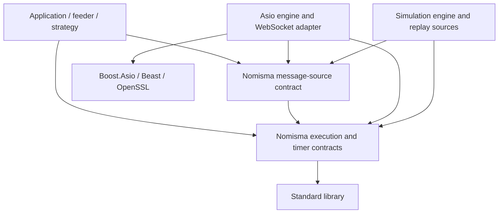

**Communication work status and execution/simulation proposal — updated 2026-11-05**

**Current implementation and example phase — COMPLETE.** WebSocket cleanup, HTTPS, the timer,
exchange examples and the connectivity runner are ready to hand over. The remaining fault
validation, exception audit, transport decisions and execution/simulation design are explicit
follow-ups; their completion is not implied by closing this phase.

<a id="https-timer-completion"></a>

**HTTPS and Timer — COMPLETE (2026-11-05)**

The agreed implementation, examples and local validation are complete. Remaining TODOs are
deferred follow-up work and do not keep this scope open.

| Component | Completed scope |
| --- | --- |
| [`nom::https`](../../docs/asio_comm/https.md) | Verified TLS HTTP/1.1; validated requests/parameters; bounded FIFO with one active request/response exchange; owned request storage and response IDs; explicit lifecycle/deadline handlers; silent client close and internal graceful shutdown; moves and callback re-entry. [`https_example`](../../apps/https_example/README.md) demonstrates Assembly/relay integration. |
| [`nom::timer`](../../docs/asio_comm/timer.md) | One-shot monotonic scheduling; generation-safe cancel/rearm; parameterless callbacks; lifetime-safe completion and moves; fatal diagnostics for unexpected backend errors. [`timer_example`](../../apps/timer_example/README.md) demonstrates rearming through Assembly/relay. HTTPS deadlines, WebSocket connection/Ping deadlines and application timers use it. |

**Deferred follow-ups**

| Area / source | Remaining work |
| --- | --- |
| HTTPS sending — [`https.cpp`](https.cpp) | Synchronous send and its queue policy; diagram of the asynchronous sending workflow; request pipelining with FIFO response association; batching complete HTTP requests into one write. These remain separate TODOs. |
| Exception audit — [WS-08](ws_current_work.md#ws-08) | Apply the agreed event/exception policy consistently to WebSocket and HTTPS and extend fault tests. Escaping transition/delegate exceptions are fatal: the outermost application handler logs and exits; no recovery/state guarantee is promised. |
| Timer logging — [`timer.cpp`](timer.cpp) | Replace the existing emergency logging with `spd_logger`'s `FATAL` helper when available. Fatal behavior is already implemented. |
| Execution and simulation | Backend-neutral executor/clock/source contracts and virtual time remain the separate proposal below. |

**Validation refreshed — 2026-11-05:** HTTPS and Timer unit suites and the HTTPS TLS loopback
suite pass in Debug and ASan/UBSan builds (three suites in each). Both examples rebuild;
the loopback suite exercises repeated HTTPS requests, and the Debug Timer example delivers
the requested three ticks. Documentation links and `git diff --check` pass.

<a id="phase-validation"></a>

**Final phase validation — 2026-11-05:** `CMAKE_BUILD_PARALLEL_LEVEL=4 ./bootstrap.sh complete`
completed from a clean `build/complete`. All **20 tests passed** (17 integration, 3 unit),
including source-tree/installed-package consumers, protocol and fault fixtures, application
shutdown and the offline connectivity runner. Python, SPDX headers, formatting and dependency
checks passed; the bootstrap recorded **11 passed, 0 failed, 0 skipped, 0 noted**.

**Live connectivity smoke check — 2026-11-05 (Singapore):** the
[saved report](../../apps/conn_test_summary.md) covers 20 feeders and 19 providers:
**37 PASS, 1 NO_DATA, 1 SKIP**, with no application failures or process timeouts. All 19 catalog
providers completed. Crypto.com's one-second feeder sample ended before data arrived; its
subscription has a one-second startup delay. Binance SBE was skipped without its API key.
This run used one second per feeder, ten seconds per provider after connection and ten seconds
between runs; providers exited on completed output. The
[runner](../../tools/asio_comm/conn_test.sh) now defaults to two seconds per feeder; the saved
report retains the timings actually used for that run.

This establishes short public-endpoint interoperability and payload receipt, not market-data
correctness or sustained availability. Long-running control-Ping checks, network blackholes,
server rotation and close-timeout coverage remain tracked in [WS-06](ws_current_work.md#ws-06).
Private-feed/order-execution validation and the deferred features remain outside the completed scope.

**Execution and simulation proposal**

Introduce Nomisma-owned execution, time, and event-source contracts so the same application
logic can run with live communication or deterministic replay. Start with `nom::timer`, a
small executor handle, and an engine that supplies time and dispatches work. Implement both
an Asio backend and a virtual-time backend early, before expanding the abstraction.

The engine and simulation contracts below remain a design proposal. Backend-neutral construction
and virtual time are not yet implemented. Names follow the repository's `snake_case` convention:
the EventEngine and EventSource concepts below are `event_engine` and `event_source`.
The current WebSocket cleanup, defects, and validation plan remain in
[ws_current_work.md](ws_current_work.md). This document owns the broader execution and
simulation design; WebSocket-specific work should link here instead of duplicating it.

**1. Why wrappers need a shared contract**

Current application code owns `boost::asio::io_context` and passes `boost::asio::any_io_executor`.
These are explicit application dependencies, declared by their includes and build targets.
Application heartbeats, subscription pacing and integration-test deadlines use `nom::timer`
with parameterless callbacks. The timer wrapper is available through `nom.asio_comm`;
neutral execution and time wrappers remain future work.

There are two additional dependencies that a timer wrapper alone would leave intact:

- [web_socket.cpp](web_socket.cpp) calls `std::chrono::steady_clock::now()` throughout its
  events and control-Ping handling. A virtual timer cannot make code using a different clock deterministic.
- WebSocket delegates receive a concrete `web_socket&`, and feeders relay borrowed payloads
  synchronously. A simulated source needs a compatible control/event contract and payload lifetime.

The objective is therefore shared observable behavior: scheduling, time, cancellation,
ordering, errors, and source lifetime. Hiding the spelling of a dependency is one consequence.

**2. Proposed concepts and responsibilities**

| Concept / proposed name | Responsibility | Ownership |
| --- | --- | --- |
| `event_engine` | Drive event processing, own a clock domain and scheduling/backend resources, and coordinate shutdown. | Owned by the application or runner; outlives its resources. |
| `executor_ref` | Identify the serial execution domain used by a component; provide deferred `post()` and `now()`. | Small non-owning handle into an engine; copying does not extend engine lifetime. |
| `event_time` and duration | Represent monotonic time within one engine's domain. | Values; not implicitly interchangeable with UTC or another engine's time. |
| `timer` | Own one scheduled deadline and its callback; support arm, rearm, and cancel. | Owned by a component; bound to one executor. |
| `event_source` | Produce typed events on an executor, with explicit activation, cancellation, and quiescence. | Owned by the application/component; engine retains only the internal state needed to finish pending work. |
| WebSocket/message source | Supply connected, data, disconnected, and failure events plus send/close control. | A concrete source backed by Asio, another transport implementation, or replay. |

An engine drives sources; a source is not a replacement name for an engine or executor.
A timer is one kind of source. A socket and a replay stream are other kinds. Their activation
methods can differ (`arm_after()`, `connect()`, `start()`); a shared lifecycle does not require
one large virtual base class containing every operation or a universal event variant.

Initially one engine has one serial execution domain and runs on the calling thread. Keep the
executor as a separate concept so components do not gain the ability to drive/stop the whole
engine and so later topology changes do not require changing every constructor. Add multiple
contexts, worker threads, affinity, and cross-thread queues only when required. A source does
not inherently own an OS thread.

The existing Assembly relay remains synchronous routing within a domain. Its
[`pass_response()` implementation](../../external/assembly/src/assembly/relay.cppm) directly
invokes the receiving node. Crossing domains must be an explicit queued operation with owned
data; placing two domains on the same thread must not turn that queue into an inline call.

**3. Small public surface and implementation choices**

Recommended initial operations, shown as a contract sketch rather than compilable declarations:

| Object | Operations | Intended semantics |
| --- | --- | --- |
| Engine driver | `executor()`, `run()`, `poll()`, `request_stop()`, `drain()` | Application-level control; define stop/drain below. |
| `executor_ref` | `now()`, `post(task)` | Read this domain's clock; enqueue owned work for later dispatch. |
| `timer` | `arm_at(time, callback)`, `arm_after(duration, callback)`, `cancel()` | One active generation; rearming replaces it. |
| Simulation driver | `step()`, `run_until(time)` | Dispatch one event, or advance and dispatch through a virtual-time boundary without sleeping. |

Keep simulation-specific stepping on the simulation driver. A real I/O engine cannot promise
to advance to a future instant immediately. Both drivers satisfy the common engine contract,
but do not need identical control surfaces or a publicly constructible abstract `event_engine`
class from day one.

`poll()` processes currently ready work without waiting or advancing virtual time. `run()`
continues while active sources or scheduled work remain, until stop or exhaustion; live
execution may wait for readiness, while simulation advances to its next known event. Keep
backend work-guard mechanics private to the engine.

Three implementation options:

| Option | Benefit | Cost / limitation |
| --- | --- | --- |
| Concrete wrappers around Asio only | Small migration; hides Boost names. | Still requires another abstraction step to run the same code with virtual time. |
| Backend-neutral handles with private type erasure | Same component types for live/replay; backend selected at composition. | Indirection and possibly allocations; lifetime and backend compatibility must be explicit. |
| Templates/concepts over an engine type | Static specialization and inlining. | Backend types propagate through component types and compilation; two instantiations of application logic. |

Recommend small type-erased handles for execution and timers, with backend state behind an
implementation boundary. Keep the application-facing API ordinary C++; Assembly can continue
to use compile-time composition. Measure dispatch and allocation cost before introducing
specialized fast paths. Do not allocate a new type-erased wrapper for each market-data message
just because the source itself is type-erased.

Asio-native access stays private to the adapter. A generic executor handle alone does not
provide everything required to construct a Beast stream. Use backend-specific construction
factories at the application composition boundary, for example
`make_asio_web_socket(asio_engine&, url)` and
`make_replay_web_socket(simulation_engine&, recording)`, returning the same neutral socket
facade. This ensures compatible resources without exporting a native executor or attempting
unchecked casts from a simulation executor to Asio.

These factories and the socket facade are proposed API. The current concrete `web_socket`
would need to be adapted to that facade, or implement a separate shared message-source
contract during migration. Merely changing its constructor parameter type is insufficient.

**4. Time, scheduling, and determinism**

Use an instance-owned clock accessed through `executor.now()`. Do not introduce a process-global
simulation clock or replace the static behavior of `steady_clock::now()` across the process.

`event_time` should be a strong value with a documented tick representation, such as signed
64-bit nanoseconds relative to the engine's origin, paired with a clock-domain identity.
Standard chrono durations can remain the duration vocabulary. Arithmetic needs range checks;
equal units do not make instants from different engine instances comparable. Bound timers and
sources to one domain and reject cross-domain scheduling rather than silently converting
between unrelated origins. Domain identity is for validation, not event ordering or replay
seeding; it need not be equal between independent runs of the same scenario.

The live backend derives elapsed time from a monotonic clock. The simulation backend advances
virtual time only under the runner's control. Keep exchange timestamps and recorded wall-clock
timestamps as separate metadata; explicitly map recorded delivery times onto the simulation
timeline. Preserve exchange sequence numbers even when exchange timestamps are equal or move
backwards. Decide whether replay models observed arrival order or exchange event time; use
recorded arrival order initially because that is the order the application actually observed.

The existing `network_timestamp` is a `steady_clock::time_point`. Migrating it to engine time
is a deliberate event-API change. Application and session deadline decisions should use the
engine clock. Record both scheduled/due time and delivery time where lateness matters; live
callbacks can be late. Virtual runs may model delivery latency explicitly rather than treating
exchange time, due time, and callback time as one timestamp.

`post()` must always defer invocation, including when called from the same domain. It must not
recursively invoke the target. Asio's `post()` provides the corresponding same-thread deferred
behavior, but the Nomisma contract should be stated independently of its backend.
[Asio post contract](https://www.boost.org/doc/libs/latest/doc/html/boost_asio/reference/post/overload1.html).

For the first simulator, use a deterministic queue ordered by virtual delivery time and a
monotonically increasing scheduling sequence. Define admission, not just the queue comparator:

- Replay input is merged in a stable order using delivery time, configured source order, and
  per-source sequence. Prefetch completion order must not determine dispatch order.
- Keep future input in the replay merger. At the next virtual time, admit all external events
  due at that instant in stable order before dispatching that instant's ready work.
- Already scheduled timers/work retain their scheduling sequence. A timer armed earlier for
  the exact arrival instant therefore precedes a newly admitted record. This is the proposed
  tie policy, not a claim about OS/network ordering; change it explicitly if the model needs
  data-before-timeout behavior.
- Work posted during a callback receives a later sequence and cannot run before its cause.
  Arming at or before `now()` queues for the current instant after already queued work.
- `run_until(t)` processes events through `t` inclusively and leaves the clock at `t`. It rejects
  backwards advancement. An event budget should detect infinite zero-time rescheduling.

For multiple replay inputs, advance only when every active input provides its next record,
end-of-stream, or a watermark proving that no event at or before the candidate instant can
still arrive from that input. A temporarily empty prefetch queue is not end-of-stream.
Start with synchronous sorted input to keep this proof simple. Reject late records initially;
any later discard policy must report data loss and must never silently rewind time.

Deterministic replay means the same inputs, ordering policy, seed, and configuration produce
the same observable sequence. It does not mean live networking has deterministic arrival order.
Parallelize independent simulation runs first; each owns its clock, state, source identities,
and random generator.

<a id="timer-cancellation"></a>

**5. Timer cancellation and lifetime**

**COMPLETE — Asio-backed timer and example (2026-11-04).** The
[timer contract](../../docs/asio_comm/timer.md) covers one-shot scheduling on `steady_clock`,
parameterless expiry callbacks, generation-safe cancellation, callback lifetime and `noexcept`
moves. Cancellation and rearming suppress obsolete completions, including success already
queued for delivery. Current-generation completion errors log and terminate; setup and callback
exceptions retain their documented propagation rules. HTTPS uses the timer for connection,
request and shutdown deadlines; WebSocket uses it for connection and active/passive Ping waits. The example
demonstrates periodic rearming through Assembly/relay.

Validation covers cancellation after queuing, delayed dispatch beyond a replacement deadline,
callback destruction/reentry, move assignment over queued expiry, moved-from reuse, executor
preservation and independent timers on separate threads. Debug and ASan/UBSan tests passed;
debugger fault injection verified both fatal diagnostic outputs and termination.

**COMPLETE — `WS-TIMER-GENERATION`:** WebSocket active/passive Ping waits now use `nom::timer`;
expiry-time guards and session-level cancellation/error handling have been removed. Protocol
timeouts still disconnect; unexpected timer errors follow the shared fatal policy.

**Separate work:** backend-neutral execution, an engine clock and simulated time remain the broader
proposal below. Consolidating emergency logging into `spd_logger`'s planned `FATAL` macro is
logger integration cleanup, not unfinished timer behavior.

**6. Event sources and simulation boundaries**

An `event_source` is initially a lifecycle concept, not a mandatory inheritance hierarchy.
Every source declares its executor, activation/control methods, typed events, cancellation
semantics, and the point after which no more user callbacks can begin. Source completions run
on the assigned serial domain, and initiating an operation does not synchronously call its
completion callback. An adapter may deliver directly from an already correctly serialized
backend completion; an extra queued hop per message is not automatically required.

Support two distinct replacement boundaries:

| Boundary | Live source | Simulated source | What it exercises |
| --- | --- | --- | --- |
| WebSocket/message stream | Asio/Beast transport | Scripted or recorded message source | Feeder subscriptions, payload handling, reconnect/deadline behavior, exchange-level heartbeats |
| Market-data events | Feeder/parser output | Recorded or synthetic domain events | Strategy and downstream event processing independently of transport/parsing |

Start with message-stream replay to reuse the current feeder path. The current feeder
`market_data` event carries raw payload views rather than a normalized order-book/trade model;
do not assume a normalized market-data schema already exists. Add the higher-level replay
boundary when that schema has a real consumer.

The shared message-source contract must define connection/disconnection, data ordering, text
versus binary if exposed, send acceptance/completion, and abort versus graceful close. Align
this with WebSocket work items 3, 7, and 8 instead of inventing different behavior for replay.
Callback parameters must refer to the neutral facade/handle, not an Asio implementation object.

For scripted outbound behavior, validate expected subscriptions/heartbeats and schedule
acknowledgements or failures with explicit model latency. A recording of inbound market data
alone cannot determine responses to arbitrary new commands. State that limitation in the
replay source contract; order execution/fill simulation would be a separate protocol model.

Preserve borrowed message data for the duration of synchronous callback/relay delivery.
Replay storage may own the underlying bytes, but consumers must obey the same lifetime rule.
Any queued handoff takes ownership or copies the payload. Do not enqueue a borrowed span from
the current Beast buffer. Backpressure and overflow must be explicit for queued sources and
posts; a simulation must not silently drop events just to keep up with wall time.

Replacing a socket with replay does not test TCP, TLS, fragmentation, or the actual Beast
timeout implementation. Keep local transport integration tests. For deterministic session
logic tests, inject neutral clock/timer behavior at the session-policy boundary; Beast's own
internal transport deadlines remain part of the live adapter until intentionally refactored.

**7. Engine lifetime and errors**

The application constructs the engine, sources, and consumers; activates them; then drives
the engine. Engine execution does not implicitly create worker threads. Sources retain their
internal pending-operation state while the engine outlives all handles.

Proposed stop/drain sequence:

1. Request stop on the engine domain; stop accepting new external work and source activations.
2. Cancel or gracefully finish sources according to their protocol; invalidate timer callbacks.
3. Drain internal completions and release queued owned payloads. A configured graceful-stop
   deadline can fall back to abort; simulation applies that deadline in virtual time.
4. Confirm callback quiescence, destroy components/sources, and destroy the engine last.

`request_stop()` starts that transition; it is not a synonym for abruptly stopping dispatch.
`drain()` must finish cancellation/release work without dispatching invalidated user callbacks
or advancing to unrelated future replay events. Keep sources alive until their terminal
notifications, if promised, have completed. A future threaded runner also has to wake and join
workers; that concern stays outside the basic timer/source abstractions.

Start with a nonthrowing user-callback contract and defined engine failure reporting. If an
unexpected exception escapes an event transition, propagate to the outermost runner to log
and exit; do not resume a partially executed simulation or promise a recoverable state.
Queue saturation, setup failure, and stopped-engine submissions need explicit results or
documented exceptions. Do not claim a blanket `noexcept` API while operations can allocate.

**8. Module and dependency direction**

Proposed logical layering:



Candidate module names are `nom.execution` for engine/executor/time/timer contracts and
`nom.comm` for transport-neutral source contracts; `nom.asio_comm` implements the live adapter.
These are proposed boundaries, not repositories or modules that exist today. Keep execution
independent of market-data schemas, TLS, and Assembly. Avoid making `base` own a networking
runtime merely to share a few types.

The current socket keeps concrete Asio/Beast/TLS state in its implementation unit, with the
executor and TLS context behind an opaque `io_state`. Its constructor still accepts a Boost
executor. The proposed neutral wrappers should also keep backend state in implementation units
and eliminate Boost types from their exported declarations. Validate consumers against the
installed package with GCC and Clang. Distinguish “consumers do not name/include Boost” from
“the live adapter no longer requires Boost to build/link”; only the first is this objective.
The neutral scheduler/simulation targets should be buildable without Boost/OpenSSL, even if
the initial physical source layout is prototyped in this repository.

Decide physical repository ownership once a small live/replay prototype proves these
contracts. A separate reusable execution component is a plausible destination; creating a
new repository or reorganizing shared build machinery is not a prerequisite for this proposal.

**9. Incremental implementation path**

These steps concern the engine and simulation layer; the completed Asio-backed timer is its
starting implementation, not an outstanding timer task.

| Step | Work | Acceptance evidence |
| --- | --- | --- |
| A | Agree time, deferred dispatch, timer cancellation, ownership, and replay tie policy. Define a tiny contract suite. | No contradictory semantics between live and simulation examples. |
| B | Implement `executor_ref`, `event_time`, and `timer` with a single-thread virtual engine. | Tests run without sleeping: arm/rearm/cancel, queued-expiry suppression, equal-time order, stop/drain, independent runs. |
| C | Implement the Asio engine/timer adapter and migrate the OKEx heartbeat. | Same timer contract tests pass; local heartbeat tests and both compiler/package consumers pass. |
| D | Move application timestamps/deadline decisions to engine time; migrate remaining feeders. | No direct wall/steady-clock reads in simulation-dependent decision paths. Migrate direct Boost application dependencies to the neutral execution/timer module. |
| E | Introduce the neutral message-source facade and a scripted/replay implementation. | The same feeder type runs against live and replay composition; owned/borrowed data rules and outbound expectations are tested. |
| F | Add merged market-data replay and deterministic fault scenarios. | Identical event traces across repeated runs; ties, delayed input, EOF, reconnect, missing heartbeat, and timer/data interaction covered. |
| G | Measure overhead and extract reusable modules; add other communication backends when needed. | Dispatch/allocation/memory measurements and backend-independent consumer builds, followed by any justified optimizations. |

For step B/C, the first shared contract test should be one deadline canceled by one received event.
Use a message arriving just before, exactly at, and just after the deadline. Then add the
heartbeat and one scripted disconnection. This proves the abstraction with a small workload
before introducing a general source registry or a complete simulation framework.

Suggested composition, illustrative only:

```cpp
// Live composition: adapter selection stays here.
nom::asio_engine engine;
auto socket = nom::make_asio_web_socket(engine, endpoint);
feed_app app{engine.executor(), socket};

// Replay composition, in a separate run/scope: the application type is the same.
nom::simulation_engine replay_engine{start_time};
auto replay_socket = nom::make_replay_web_socket(replay_engine, recording);
feed_app replay_app{replay_engine.executor(), replay_socket};
```

The runner activates the app and uses `run()` for live operation or `run_until()`/`step()` for
replay, then performs the stop/drain sequence. `feed_app` sees only the neutral executor,
timer, and message-source contracts. Driver and source selection are composition decisions.

**10. Relationship to the WebSocket work**

WebSocket mechanical cleanup remains complete. The wrapper proposal is substantive new design
work prompted by the alternate-backend and simulation use cases. It expands the former
optional Boost-wrapper question into a concrete direction, while leaving the design choices
above reviewable.

Continue independent WebSocket contract/state/cleanup fixes from [ws_current_work.md](ws_current_work.md).
Before redesigning its timers and timestamp types, settle steps A–C here so those fixes can use
the chosen engine contract. The current blocking send still needs its own asynchronous-write
and backpressure work; an engine wrapper cannot make a blocking operation nonblocking.

Validation of the engine/simulation proposal is source review, contract consistency, and
local-link checks. Its unimplemented contracts imply no performance or simulation correctness claim.
